# 🏛️ LiftAssistant 3.0: Architecture Decision Record (ADR)

**Document Version:** 1.0  
**Date:** November 2026  
**Status:** Approved / In Design  

This document formalizes the architectural decisions, design rationale, and technical standards for evolving LiftAssistant from an automated reminder engine into a comprehensive **Personal Life OS, Digital Ledger, and Mobile-Friendly Assistant**.

---

## 1. Decision 1: Unified Lifecycle Event Model (`scheduled_at` & `completed_at`)

### Context & Problem
Previously, personal systems separated "Tasks" (future to-dos), "Financial Tracking" (receipts and expenses), and "Location / Life Logs" (places visited) into disconnected silos, or used artificial enums like `PAST_RECORD` vs `FUTURE_TASK`. 

In reality, any event—whether a dinner reservation, a shopping trip, an oil change, or a swimming lesson—moves along the exact same continuum. A dining event at a restaurant can be planned for next Friday, and then marked completed with a receipt and photos when it actually happens.

### Decision
Eliminate separate temporal types. All events use a unified **`events`** model governed by two primary timestamps:
- **`scheduled_at`** (TIMESTAMP, Optional): When the event is planned or expected to occur.
- **`completed_at`** (TIMESTAMP, Optional): When the event actually occurred or was fulfilled.

### State Derivation:
- **Upcoming Future Event / Task**: `completed_at IS NULL` AND `scheduled_at > NOW()`
- **Overdue / Due Now**: `completed_at IS NULL` AND `scheduled_at <= NOW()`
- **Completed Plan**: `scheduled_at IS NOT NULL` AND `completed_at IS NOT NULL`
- **Retroactive Past Log (e.g., spontaneous dining, receipt upload)**: `completed_at IS NOT NULL` (`scheduled_at` can default to same or NULL).

### Lifecycle Transition
- When completing a planned event, setting `completed_at = NOW()` seamlessly transitions it from your upcoming tasks into your permanent daily chronicle, allowing you to attach receipts, spend, rating, or notes.
- When logging a past event (e.g. replacing a fridge filter today), the AI agent can spawn a new event with `scheduled_at = TODAY + 6 months` and `completed_at = NULL`.

---

## 2. Decision 2: Mobile-First Frontend Framework — Mantine (All-in-One)

### Context & Problem
The legacy dashboard used **Streamlit**, which is desktop-centric, triggers full script reruns on every interaction, lacks smooth mobile touch gestures, cannot easily access phone cameras for instant receipt scanning, and cannot be installed as a mobile app.

### Decision
Adopt **Next.js** paired with **Mantine v7** (`@mantine/core`, `@mantine/notifications`, `@mantine/hooks`, `@tabler/icons-react`) as the primary frontend framework.

### Rationale
- **All-in-One Simplicity**: Unlike assembling dozens of separate libraries and Tailwind config files, Mantine provides components, dark/light theme switching, notifications, responsive layouts, and hooks out of the box in a unified package.
- **Built-in Mobile Responsiveness**:
  - `<AppShell>` collapses the navbar into a mobile drawer automatically.
  - `<Drawer position="bottom">` provides native iOS/Android-style bottom sheets.
  - `<LoadingOverlay>` provides instant blur-and-spinner states during AI receipt processing.
  - `@mantine/notifications` gives stacked, swipeable toast notifications.

---

## 3. Decision 3: Next.js + FastAPI Decoupled Architecture

### Context & Problem
We need Python for data processing, database operations, email parsing, and LLM integrations, while needing a responsive modern web and mobile frontend.

### Decision
Run a decoupled frontend and backend:
1. **Backend**: Python **FastAPI** (`uvicorn`) running on port `8000`.
2. **Frontend**: **Next.js** running on port `3000`.
3. **Proxy Connection**: Next.js proxies all `/api/py/:path*` requests directly to FastAPI via `next.config.mjs` rewrites.

### Rationale
- **Zero CORS Issues**: All browser and mobile traffic uses relative paths (`/api/py/...`).
- **Direct Mobile Camera Support**: Standard HTML5 file inputs (`accept="image/*" capture="environment"`) trigger native smartphone cameras directly for checkout receipt photos.
- **PWA (Progressive Web App)**: Can be added to the mobile home screen for a full-screen, native-app feel.
- **Single Process in Production**: Next.js static export (`output: 'export'`) can be served directly by FastAPI's `StaticFiles`.

---

## 4. Decision 4: Multimodal Receipt Scanning & Pantry Inventory

### Context & Problem
Users buy groceries and household goods regularly but have to manually type shopping lists and don't know what is in stock at home.

### Decision
1. **Receipt Ingestion**: Use a Multimodal Vision LLM (e.g. Gemini 1.5 Flash) with structured Pydantic schemas to extract:
   - Store name, address, purchase date, total amount, tax.
   - Itemized line items (`raw_name`, `clean_name`, `category`, `quantity`, `unit_price`, `total_price`).
2. **Inventory Tracking**: Upsert line items into `inventory_items` table (Pantry / Household).
3. **Smart Shopping List**:
   - Items with low stock or approaching estimated lifespan auto-queue onto the `shopping_list`.
   - Matching items currently on the shopping list are auto-checked off when a receipt containing them is uploaded.

---

## 5. Decision 5: Map API Abstraction (`BaseMapProvider`)

### Context & Problem
Logging places (restaurants, stores, gyms, doctors) requires accurate names, addresses, coordinates, and navigation links. Tying the application directly to a single commercial map service (like Google Maps) creates vendor lock-in and mandatory API key hurdles.

### Decision
Abstract all mapping and geocoding behind a standard `BaseMapProvider` interface using `geopy`:
- **Standard Model**: `PlaceInfo` (containing `place_id`, `name`, `category`, `address`, `latitude`, `longitude`, `map_url`).
- **Default Implementation**: **OpenStreetMap (`Nominatim`)** — 100% free, open-source, zero API keys required.
- **Commercial Fallback / Upgrades**: Drop-in support for **Google Places API** (`GoogleV3`) or **Mapbox** enabled via environment variables (`MAP_PROVIDER="google"`).

---

## 6. Decision 6: GroupEx PRO Live Schedule Scraping for YMCA Facilities

### Context & Problem
Facility classes (such as Aqua Zumba or Water Aerobics in the Rose E. Schneider Family YMCA Warm Water Pool) occupy facilities and conflict with open swimming or lesson sign-ups.

### Decision
Query the live **GroupEx PRO API** directly (`a=793`, `location=3827`, `studio=15080` for Warm Water Pool) rather than brittle browser automation:
- Parsed into `life_events` as calendar busy blocks: `Busy: Warm Pool Occupied (<Class Name>)`.
- Provides an automated conflict-checking helper (`check_conflict(start, end)`) before swimming lessons are booked.

---

## 7. Decision 7: First-Class `Place` Model & Joined-Table Relational Polymorphism

### Context & Problem
Events can represent fundamentally different activities (Dining, Shopping, Household Maintenance, Kids' Activities). Storing type-specific attributes in untyped JSON blobs loses relational integrity:
- You cannot enforce foreign key constraints (e.g. linking maintenance to a specific vehicle/appliance, or linking a shopping trip to an inventory item).
- Places (gyms, restaurants, supermarkets) would be duplicated as unnormalized text strings across hundreds of rows instead of being reusable entities.

### Decision
1. **First-Class `Place` Entity (`places`)**:
   - Places are distinct, reusable entities in your life (e.g., *"Rose E. Schneider Family YMCA"*, *"Mad Mex"*, *"Costco Cranberry"*).
   - Events link to places via `place_id REFERENCES places(id)`.
   - Allows querying your favorite/most visited places, searching past events by venue, and mapping your life history.
2. **Joined-Table Relational Polymorphism (Class Table Inheritance)**:
   - **Base Table (`events`)**: Holds universal lifecycle fields (`id`, `title`, `event_type`, `scheduled_at`, `completed_at`, `place_id`, `total_amount`, `notes`).
   - **Type-Specific Extension Tables (1-to-1 FK with `ON DELETE CASCADE`)**:
     - **`dining_details`**: `cuisine`, `meal_type`, `rating`, `attendees`.
     - **`shopping_details`**: `receipt_image_path`, `payment_method`, `pantry_updated`, linked to `receipt_items` and `inventory_items`.
     - **`maintenance_details`**: `equipment_id REFERENCES household_equipment(id)`, `odometer_miles`, `next_due_interval_days`.
     - **`kid_activity_details`**: `child_name`, `activity_type`, `studio_name` (e.g., *Warm Water Pool*), `instructor`.

---

## 8. Enhanced Entity-Relationship (EER) Architecture Diagram

```mermaid
erDiagram
    PLACES ||--o{ EVENTS : "hosts / visited at"
    PLACES ||--o{ PRODUCTS : "default store for"
    PLACES ||--o{ SHOPPING_LIST : "target store for"

    PLACES {
        string id PK
        string name
        string category
        string address
        float latitude
        float longitude
        string google_place_id
        string map_url
        string notes
    }

    EVENTS ||--o| DINING_DETAILS : "specializes (1:1)"
    EVENTS ||--o| SHOPPING_DETAILS : "specializes (1:1)"
    EVENTS ||--o| MAINTENANCE_DETAILS : "specializes (1:1)"
    EVENTS ||--o| KID_ACTIVITY_DETAILS : "specializes (1:1)"
    EVENTS ||--o{ RECEIPT_ITEMS : "itemized on"
    EVENTS ||--o{ STOCK : "purchased via"

    EVENTS {
        string id PK
        string title
        string event_type "DINING, SHOPPING, MAINTENANCE, KID_ACTIVITY, GENERIC"
        timestamp scheduled_at "When planned (NULL if retroactive log)"
        timestamp completed_at "When fulfilled (NULL if upcoming task)"
        boolean all_day
        string place_id FK
        float total_amount
        float tax_amount
        string notes
        string source "MANUAL, RECEIPT_OCR, AGENT_GMAIL, AGENT_YMCA"
        string source_reference_id
    }

    DINING_DETAILS {
        string event_id PK,FK
        string cuisine
        string meal_type "breakfast, lunch, dinner, drinks"
        integer rating "1 to 5 stars"
        string attendees "JSON list"
    }

    SHOPPING_DETAILS {
        string event_id PK,FK
        string receipt_image_path
        string payment_method
        boolean pantry_updated
    }

    HOUSEHOLD_EQUIPMENT ||--o{ MAINTENANCE_DETAILS : "serviced in"
    HOUSEHOLD_EQUIPMENT {
        string id PK
        string name "Honda Odyssey, Kitchen Fridge"
        string category "vehicle, appliance, hvac"
        string model_number
        string serial_number
        date warranty_expiry
    }

    MAINTENANCE_DETAILS {
        string event_id PK,FK
        string equipment_id FK
        integer odometer_miles
        string service_type
        integer next_due_interval_days
        integer next_due_miles
    }

    KID_ACTIVITY_DETAILS {
        string event_id PK,FK
        string child_name
        string activity_type "swimming, soccer, piano"
        string facility_studio "Warm Water Pool"
        string instructor
    }

    STORAGE_LOCATIONS ||--o{ PRODUCTS : "default storage for"
    STORAGE_LOCATIONS ||--o{ STOCK : "physically stored at"
    STORAGE_LOCATIONS {
        string id PK
        string name "Kitchen Fridge, Pantry, Freezer, Basement"
        string description
    }

    QUANTITY_UNITS ||--o{ PRODUCTS : "purchased in"
    QUANTITY_UNITS ||--o{ PRODUCTS : "tracked in"
    QUANTITY_UNITS ||--o{ SHOPPING_LIST : "measured in"
    QUANTITY_UNITS {
        string id PK
        string name "piece, pack, can, gallon, lb, box"
        string name_plural
    }

    PRODUCTS ||--o{ STOCK : "inventory batches of"
    PRODUCTS ||--o{ RECEIPT_ITEMS : "matched to"
    PRODUCTS ||--o{ SHOPPING_LIST : "replenished on"
    PRODUCTS {
        string id PK
        string name
        string category "produce, dairy, meat, household"
        string default_location_id FK
        string default_place_id FK "Default store (e.g. Costco)"
        string qu_purchase_id FK "e.g. Pack"
        string qu_stock_id FK "e.g. Can"
        float qu_factor "1 pack = 12 cans"
        float min_stock_amount "Auto-reorder threshold"
        integer default_best_before_days
        integer estimated_lifespan_days "Consumption cycle"
        boolean auto_add_to_shopping_list
    }

    STOCK {
        string id PK
        string product_id FK
        float amount "Quantity in stock units"
        string location_id FK
        string purchased_event_id FK
        float price
        date best_before_date
        boolean opened
        date opened_date
    }

    RECEIPT_ITEMS {
        string id PK
        string event_id FK
        string raw_text "Raw line from receipt OCR"
        string clean_name
        string category
        float quantity
        string unit
        float unit_price
        float total_price
        string product_id FK
    }

    SHOPPING_LIST {
        string id PK
        string product_id FK "Nullable: allows ad-hoc items"
        string item_name
        float amount
        string qu_id FK
        string target_place_id FK "Store grouping (e.g. Costco tab)"
        string status "PENDING, IN_CART, PURCHASED"
        string source "MANUAL, MIN_STOCK_TRIGGER, AI_ESTIMATE"
    }
```



---

## 9. Decision 9: Asynchronous Ingestion & Receipt Address Ground Truth

### Context & Problem
Users rarely photograph receipts at the checkout register—photos are typically snapped hours later in a hotel room, in a car, or days later after returning home. If the system relied on the device's live GPS coordinates at the moment of upload, a vacation receipt uploaded from home would be falsely attributed to the home address and excluded from the trip ledger.

### Decision
1. **Receipt Header as Ground Truth**: The physical address, city, store number, or merchant phone number printed on the receipt header is the primary source of truth for location.
2. **Device GPS Exclusion**: The phone's live GPS location is strictly ignored during receipt uploads, ensuring that retroactively scanned receipts from past days or travels are placed at their true venue and timestamp. Phone GPS is only used for the live 1-tap "I am here" check-in button.

---

## 10. Decision 10: Omnichannel Receipt Pipeline (Reusability Across Photos & Emails)

### Context & Problem
A large percentage of modern receipts arrive digitally via email (e.g., Amazon orders, Uber/Lyft rides, Square/Toast digital diner receipts, airline tickets, PDF invoices). If the downstream processing logic (Map resolution, Trip attribution, Event recording, Pantry inventory updates, Shopping list reconciliation) is tightly coupled to image uploads, that complex logic would have to be duplicated for email parsing.

### Decision
Decouple **Channel-Specific Extraction** from **Unified Downstream Processing** using a standard Adapter Pattern:

1. **Normalized Intermediate Model (`StandardizedReceipt`)**:
   - `merchant_name`: str
   - `merchant_address`: Optional[str]
   - `transaction_time`: datetime
   - `total_amount`: float, `tax_amount`: float, `tip_amount`: Optional[float]
   - `payment_method`: Optional[str]
   - `line_items`: list[StandardizedLineItem]
   - `source_channel`: `PHOTO_UPLOAD` | `EMAIL_BODY` | `PDF_ATTACHMENT` | `MANUAL`
   - `source_reference_id`: str (file path or Gmail message ID)
2. **Pluggable Extractors (Adapters)**:
   - `PhotoReceiptExtractor`: Takes raw image bytes $\to$ calls Multimodal Vision LLM $\to$ returns `StandardizedReceipt`.
   - `EmailReceiptExtractor`: Takes Gmail HTML/text $\to$ calls LLM / parser $\to$ returns `StandardizedReceipt`.
   - `PdfInvoiceExtractor`: Takes PDF attachment $\to$ extracts text/OCR $\to$ returns `StandardizedReceipt`.
3. **Single Reusable Downstream Pipeline (`ReceiptIngestionPipeline`)**:
   - Executes the identical 5-step sequence regardless of origin:
     1. `MapService.resolve_place(receipt.merchant_name, receipt.merchant_address)`
     2. `TripAttributionEngine.evaluate_trip_association(receipt.transaction_time, place, category)`
     3. `EventManager.create_event(event_type='SHOPPING' | 'DINING', ...)`
     4. `InventoryService.process_receipt_line_items(receipt.line_items)`
     5. `InventoryService.reconcile_shopping_list(receipt.line_items)`

---

## 11. Decision 11: APScheduler In-Process Background Worker Engine

### Context & Problem
LiftAssistant 2.0 used an unmanaged `threading.Thread` with a 5-second sleep loop, which drifted and missed runs if the computer was asleep at 7:00 AM. Heavy enterprise workers like Celery or RQ require external Redis/RabbitMQ infrastructure that is overkill for a personal assistant.

### Decision
Use **APScheduler (Advanced Python Scheduler)** running inside the FastAPI `lifespan` context:
- Zero external daemon/Redis dependencies.
- `CronTrigger(hour=7, minute=0)` with `misfire_grace_time=7200`: if the computer is asleep at 7:00 AM, the job executes automatically upon waking.
- SQLite persistent job store.

---

## 12. Decision 12: Idempotent Background Job Architecture

### Context & Problem
Background jobs may be triggered multiple times due to server restarts, misfire catch-up, or manual "Run Now" clicks. Non-idempotent jobs would double-deduct inventory, flood calendars with duplicate classes, or send multiple alert notifications.

### Decision
Every background worker is guarded by a deterministic deduplication key:
1. **Pantry Depletion**: Guarded by `(product_id, CURRENT_DATE)`. Skips if already evaluated or pending today.
2. **YMCA / Facility Sync**: Guarded by `UNIQUE(source, source_reference_id)`. Upserts in-place without duplicate events.
3. **Gmail Ingestion**: Guarded by `source_reference_id = gmail_message_id`. Checks database before calling LLM or inserting records.
4. **Maintenance Horizon**: Guarded by `(equipment_id, scheduled_date)`. Skips if pending occurrence exists.
5. **Daily Briefing**: Guarded by `PRIMARY KEY (briefing_date)` with `notified_at` check.

---

## 13. Decision 13: Generic Rule-Based Conflict Engine (`ConflictEngine`)

### Context & Problem
Facility classes (like YMCA pool closures) are just one manifestation of a universal scheduling problem. Events from manual entry, email parsing, community workshops (Lowe's, Home Depot), and LLM sign-up agents can all collide.

### Decision
Implement a centralized, generic **`ConflictEngine`** evaluating 4 distinct conflict dimensions:
1. **Resource / Facility Mutex**: Is the physical room/studio occupied? (`resources` table).
2. **Person / Attendee Availability**: Is the child or parent double-booked? (`people` table).
3. **Travel & Transit Buffers**: Can the driver physically travel between Venue A and Venue B in time? (Calculated via `MapService`).
4. **Family Blackout Policies**: Does it violate family rules (e.g. no activities after 7:30 PM on school nights)?

---

## 14. Decision 14: Non-Polluting Resource Scheduling via Pluggable Providers

### Context & Problem
Pre-fetching every class from every facility (YMCA warm pool, lap pool, Lowe's workshops) into the user's personal calendar would clutter the database with hundreds of unused aerobic classes.

### Decision
1. **Personal Calendar (`events`) Only Stores Personal Life**:
   - `is_blocking = TRUE`: For hard personal commitments (Doctor, Marcus's soccer) that block time.
   - `is_blocking = FALSE`: For flexible tasks (Trash day, Pay bill) that do not block time.
2. **External Facilities Queried On-Demand**:
   - Implement `BaseFacilityProvider` (e.g. `YmcaScheduleProvider`, `LowesWorkshopProvider`).
   - Facility availability is checked on-demand (with a 4-hour memory cache) only when an event at that facility is being scheduled or validated.

---

## 15. Decision 15: Soft-Conflict Tolerance & Event Resolution Lifecycle

### Context & Problem
Users often sign up for events outside the app (in person, on phone, on work browser), and the confirmation email arrives later. If the app hard-rejected conflicting events, it would create a dangerous blind spot where real-world bookings are hidden from the user.

### Decision
1. **Never Silently Reject Confirmed Bookings**: All ingested events are saved, but flagged if a conflict is detected.
2. **Explicit Conflict Fields on `events`**:
   - `has_conflict`: BOOLEAN DEFAULT FALSE
   - `conflict_status`: `'DETECTED'` | `'ACKNOWLEDGED'` | `'RESOLVED'`
   - `conflict_reason`: Human-readable explanation of why it conflicts.
   - `conflicting_event_id`: FK to the overlapping personal event (if applicable).
3. **UI Resolution Workflows**:
   - High-visibility warning badge on the card and top banner.
   - 1-click actions: `[ Reschedule ]`, `[ Acknowledge / Ignore ]`, `[ Cancel Event ]`.

---

## 16. Decision 16: Hybrid Conflict Resolution (Instant Reactive Hooks + Daily Drift Sweep)

### Context & Problem
Waiting for a periodic hourly cron to resolve conflicts causes UI lag: if a user deletes an overlapping dental appointment, the soccer practice still shows a red conflict warning for up to an hour. Conversely, ignoring external schedule changes risks missing new facility closures.

### Decision
1. **Instant Reactive Hook (`on_event_deleted` / `on_event_rescheduled`)**:
   - Deleting or moving an event immediately queries and re-evaluates all affected peers in `< 2 milliseconds`.
   - The conflict badge on the remaining event disappears instantly.
2. **Daily Morning Drift Sweep (07:15 AM)**:
   - Sweeps future upcoming events in the 30-day window to catch unexpected external facility closures or airline flight time changes. No need to poll every hour.

---

## 17. Decision 17: Autonomous Web Browser Receipt Agents (Costco / Retail Portals)

### Context & Problem
Many major retailers (most notably Costco) do not email itemized purchase receipts for in-warehouse shopping trips. Instead, full itemized receipts are stored inside the user's password-protected account portal under *Orders & Purchases -> In-Warehouse*. Relying solely on paper OCR or email parsing misses these digital warehouse receipts.

### Decision
Implement an autonomous headless browser agent (`CostcoWebAgent`) powered by Playwright / OpenClaw browser automation:
1. **Persistent Session Context**: Browser cookies and authentication tokens are persisted in an encrypted local data directory, ensuring that two-factor authentication (2FA) is only completed once during initial setup.
2. **Multi-Step Action Chain**:
   - Launches stealth headless browser to Costco.com.
   - Navigates to *Orders & Purchases -> In-Warehouse Receipts*.
   - Scrapes recent transaction headers (Warehouse #, Date, Register #, Trx #).
3. **Idempotency Check Before Extraction**:
   - Each transaction has a deterministic natural key:  
     `sig = f"costco_wh_{warehouse_num}_{register_num}_{trx_num}_{date}"`
   - If `sig` already exists in `receipts.source_reference_id`, the agent skips it immediately.
4. **Handoff to Omnichannel Pipeline**:
   - Scrapes the exact item numbers, descriptions, quantities, and prices from the DOM (or downloads the official receipt PDF).
   - Normalizes data into `StandardizedReceipt` and passes it directly to `ReceiptIngestionPipeline.process()`.
5. **Execution Triggers**:
   - 1-click on-demand sync button in the Mantine UI: `[ 🛒 Sync Costco.com Purchases ]`.
   - Conversational OpenClaw chat command (e.g., via WhatsApp / Telegram).
   - Optional weekly background worker.

---

## 18. Decision 18: Content-Addressable Receipt Storage (CAS) & Reprocessing Architecture

### Context & Problem
Receipt files arrive from multiple channels (mobile camera photos, Gmail PDF attachments, local folder dropzone, or email HTML) in diverse formats:
- **Images**: `.jpg`, `.jpeg`, `.png`, `.webp`, `.heic` (Paper receipt photos)
- **Documents**: `.pdf` (Digital invoices, store PDF receipts)
- **Structured Data**: `.csv`, `.json` (Credit card/bank transaction exports, Costco/Amazon JSON or CSV order exports)

If raw files are stored with arbitrary or temporary filenames:
1. Re-uploading the exact same receipt creates duplicate records, double-charges the ledger, and duplicates inventory.
2. If an extraction error occurs, the original source file is lost or detached, making it impossible to regenerate without asking the user to re-upload.

### Decision
Implement **Content-Addressable Storage (CAS)** for all incoming receipt formats:
1. **SHA-256 Hash as Immutable Identity**:
   - The moment any file (image, PDF, CSV, or JSON) arrives, compute its SHA-256 hash:  
     `sha256 = hashlib.sha256(file_bytes).hexdigest()`
2. **Instant Zero-Cost Deduplication**:
   - Check SQLite: `SELECT id FROM receipts WHERE file_hash = :sha256`.
   - If a match exists: **Immediate Deduplication Hit**. Skip all extraction and return the existing record.
3. **Standardized Permanent Store (`data/receipt_store/`)**:
   - Files are copied into a permanent storage directory named strictly by hash and extension:  
     `data/receipt_store/YYYY-MM/{file_hash}.{ext}` (e.g. `.../{hash}.pdf`, `.../{hash}.csv`, `.../{hash}.json`).
4. **Pluggable File Parsers by Format**:
   - **Image (`.jpg`, `.png`)**: Parsed via `ReceiptVisionService` (Gemini Multimodal LLM).
   - **Document (`.pdf`)**: Parsed via `PdfInvoiceExtractor` (PDF text extractor / OCR fallback).
   - **Structured (`.csv`, `.json`)**: Parsed via `CsvReceiptExtractor` or `JsonReceiptExtractor` directly into `StandardizedReceipt` with **zero LLM cost and instant execution**!
5. **Permanent Reference in `receipts` Table**:
   - `file_hash TEXT UNIQUE NOT NULL`
   - `file_path TEXT NOT NULL`
   - `original_filename TEXT`
   - `mime_type TEXT` (`application/pdf`, `image/jpeg`, `text/csv`, `application/json`)
   - `parsing_status TEXT DEFAULT 'SUCCESS'`
   - `parsing_error TEXT`
6. **1-Click Regeneration & Reprocessing**:
   - The user (or automated retry) can click `[ 🔄 Reprocess Receipt ]` anytime.
   - The backend re-reads the exact original file from `file_path` and re-runs the parser.

---

## 19. Decision 19: Two-Tier Hybrid Schema Mapping for Heterogeneous CSV/JSON

### Context & Problem
Unlike paper receipts which are handled by Multimodal Vision LLMs, CSV and JSON receipts arrive from hundreds of different merchants, banks (Chase, Amex, Apple Card), and retail order portals (Costco, Amazon), each using completely different column names, date structures, and schemas. Parsing every row with an LLM is slow and cost-prohibitive, but hardcoding every merchant's CSV format is brittle.

### Decision
Implement a **Two-Tier Hybrid Schema Mapping Engine**:
1. **Tier 1: Fuzzy Header Aliases & Pre-Built Profiles (Zero LLM, < 1ms, $0)**:
   - Includes alias dictionaries for core attributes (`date`, `merchant`, `amount`, `category`, `quantity`).
   - Includes pre-built profiles for major providers (Chase, Amex, Costco exports, Amazon order history).
   - If headers match with $> 90\%$ confidence, the file is parsed deterministically in milliseconds with zero LLM API calls.
2. **Tier 2: One-Shot Header-Only LLM Mapping (For Novel / Obscure Merchant Formats)**:
   - When an unrecognized CSV/JSON format arrives, the system sends **only the header row and 1 sample row (~50 tokens)** to the LLM.
   - The LLM returns a column mapping dictionary (e.g. `{"date": "trx_dt_iso", "merchant": "vdr_lbl", "amount": "fin_chg"}`).
   - The mapping is saved to `data/schema_mappings.json`.
3. **Cached Deterministic Execution**:
   - All rows in the file, and all future files matching those headers, are parsed deterministically using the cached mapping with **zero future LLM calls**.

---

## 20. Decision 20: Self-Synthesizing Dynamic Parsers (Code Generation for Arbitrary Formats)

### Context & Problem
JSON data in the real world is rarely flat. Different merchants, banking APIs, and web services output deeply nested trees, arrays of objects, GraphQL structures, and irregular timestamp formats (e.g. `order.delivery.address`, `line_items[].pricing.cents / 100`, or epoch timestamps). 

Assuming a fixed or flat JSON structure is guaranteed to fail, and calling an LLM on every single row/transaction is cost-prohibitive and slow.

### Decision
Implement **Self-Synthesizing Dynamic Parsers (Agentic Code Generation & Plugin Caching)**:
1. **Structural Fingerprinting**:
   - When a new JSON/CSV file arrives, compute a structural hash of its schema/keys:  
     `fingerprint = hash_schema_structure(sample_data)`
2. **Check Dynamic Parser Registry (`data/parsers/`)**:
   - Check if a compiled parser already exists for this fingerprint: `data/parsers/parser_{fingerprint}.py`.
   - If found $\longrightarrow$ dynamically load and execute the Python function directly (**`< 1ms`, \$0 cost**).
3. **If Unknown $\longrightarrow$ LLM One-Shot Code Synthesizer**:
   - Send the sample structure to the LLM with a strict prompt:  
     *"Analyze this JSON/CSV sample. Write a pure Python function `parse(raw_data: Any) -> StandardizedReceipt` that extracts merchant, date, total, and line items into our Pydantic model."*
4. **Sandboxed Verification & Self-Testing**:
   - The backend runs the synthesized Python code on the sample data inside a safe execution sandbox.
   - It verifies that the returned object satisfies the Pydantic `StandardizedReceipt` schema with zero errors.
5. **Persist the Generated Parser Plugin**:
   - Save the validated Python code to `data/parsers/parser_{fingerprint}.py`.
   - All subsequent files or rows matching this structure execute natively via the generated Python code at pure CPython speed with **zero future LLM API calls**.

---

## 21. Decision 21: Synchronous Atomic Transactions & Domain Natural Key Idempotency

### Context & Problem
In mobile and web environments, network connections drop, smartphones retry requests, server processes restart mid-operation, and autonomous agents retry API calls. If mutations (creating events, adding receipts, logging stock transactions, adding shopping items) are not strictly idempotent and atomic:
- Retrying an upload creates duplicate events.
- Retrying an inventory update double-deducts or double-increments stock.
- Dropped mobile responses or partial crashes leave orphaned records (e.g., event created without receipt items).

### Decision
Rather than introducing complex HTTP-layer caching tables (e.g. `idempotency_records`), we enforce **Synchronous Atomic Transactions** paired with **Deterministic Domain Natural Keys and CAS (Content-Addressable Storage)**:

```
[ Incoming Mutation Request (e.g., Receipt Upload) ]
                      │
                      ▼
┌────────────────────────────────────────────────────────┐
│ Step 1: Compute File Hash (SHA-256)                    │
│ • Check receipts table: `SELECT id FROM receipts...`   │
│ • If file_hash exists: Return existing receipt record  │
│   (Zero LLM token cost, zero duplicate execution)      │
└─────────────────────┬──────────────────────────────────┘
                      │ First Time Seen
                      ▼
┌────────────────────────────────────────────────────────┐
│ Step 2: Ingest & Parse (Vision / PDF / CSV / JSON)    │
│ • Copy file to `data/receipt_store/{hash}.{ext}`       │
│ • Execute format-specific parser / LLM                 │
└─────────────────────┬──────────────────────────────────┘
                      │
                      ▼
┌────────────────────────────────────────────────────────┐
│ Step 3: Synchronous Atomic Database Transaction        │
│   BEGIN TRANSACTION;                                   │
│     1. INSERT INTO events (...)                        │
│     2. INSERT INTO receipts (...)                      │
│     3. INSERT INTO receipt_items (...)                 │
│     4. INSERT INTO stock_transactions (...)            │
│   COMMIT;                                              │
│ • Guarantees 100% all-or-nothing atomicity             │
│ • Guaranteed retry safety via natural unique keys      │
└────────────────────────────────────────────────────────┘
```

#### Deterministic Natural Keys (Database Engine Level)
The database engine guarantees idempotency via deterministic unique constraints:

| Mutation | Deterministic Natural Key | Behavior on Retry / Re-run |
| :--- | :--- | :--- |
| **`add_receipt`** | **`file_hash`** (SHA-256) | `SELECT 1 FROM receipts WHERE file_hash = ?`. Returns existing receipt; zero duplicate ledger entries. |
| **`create_event`** | **`source_reference_id`**<br>*(e.g., Gmail msg_id, YMCA class sig)* | `INSERT ... ON CONFLICT(source, source_reference_id) DO UPDATE`. In-place UPSERT; zero duplicate events. |
| **`record_stock_purchase`** | **`(event_id, product_id, 'PURCHASE')`** | `UNIQUE(event_id, product_id, transaction_type)`. Prevents double-incrementing inventory on re-runs. |
| **`queue_shopping_item`** | **`(product_id, status='PENDING')`** | If already pending, updates quantity/timestamp rather than inserting duplicate rows. |
| **`create_trip`** | **`(name, start_date)`** | `UNIQUE(name, start_date)`. Prevents duplicate vacation containers. |

---

## 22. Summary Database Schema (`liftassistant.db`)

```sql
-- =========================================================================
-- 1. FIRST-CLASS PLACES & VENUES
-- =========================================================================
CREATE TABLE IF NOT EXISTS places (
    id TEXT PRIMARY KEY,
    name TEXT NOT NULL,           -- e.g. "Rose E. Schneider Family YMCA", "Mad Mex"
    category TEXT,                 -- 'restaurant', 'supermarket', 'gym', 'school', 'medical'
    address TEXT,                 -- Full formatted street address
    latitude REAL,
    longitude REAL,
    map_url TEXT,                 -- Navigation link
    google_place_id TEXT,         -- Unique provider identifier
    notes TEXT,                   -- Parking tips, favorite seats, entrance instructions
    created_at TIMESTAMP DEFAULT CURRENT_TIMESTAMP,
    updated_at TIMESTAMP DEFAULT CURRENT_TIMESTAMP
);

-- =========================================================================
-- 2. BASE EVENTS TABLE (Universal Lifecycle Engine)
-- =========================================================================
CREATE TABLE IF NOT EXISTS events (
    id TEXT PRIMARY KEY,
    title TEXT NOT NULL,
    event_type TEXT NOT NULL,     -- 'DINING', 'SHOPPING', 'MAINTENANCE', 'KID_ACTIVITY', 'GENERIC'
    
    -- Two Core Timestamps Defining Lifecycle
    scheduled_at TIMESTAMP,       -- When planned / expected to happen (NULL if spontaneous log)
    completed_at TIMESTAMP,       -- When actually happened / fulfilled (NULL if upcoming task)
    all_day BOOLEAN DEFAULT FALSE,
    
    -- First-Class Place Foreign Key
    place_id TEXT REFERENCES places(id) ON DELETE SET NULL,
    
    -- Financials & Notes
    total_amount REAL,
    tax_amount REAL DEFAULT 0.0,
    notes TEXT,
    
    -- Origin & Automation Source
    source TEXT NOT NULL,         -- 'MANUAL', 'RECEIPT_OCR', 'AGENT_GMAIL', 'AGENT_YMCA'
    source_reference_id TEXT,
    
    created_at TIMESTAMP DEFAULT CURRENT_TIMESTAMP,
    updated_at TIMESTAMP DEFAULT CURRENT_TIMESTAMP
);

CREATE INDEX IF NOT EXISTS idx_events_scheduled ON events(scheduled_at);
CREATE INDEX IF NOT EXISTS idx_events_completed ON events(completed_at);
CREATE INDEX IF NOT EXISTS idx_events_place ON events(place_id);
CREATE INDEX IF NOT EXISTS idx_events_type ON events(event_type);

-- =========================================================================
-- 3. TYPE-SPECIFIC EXTENSION TABLES (Polymorphic Joined Tables)
-- =========================================================================

-- Dining Specifics
CREATE TABLE IF NOT EXISTS dining_details (
    event_id TEXT PRIMARY KEY REFERENCES events(id) ON DELETE CASCADE,
    cuisine TEXT,                 -- 'Mexican', 'Italian', 'Sushi'
    meal_type TEXT,               -- 'breakfast', 'lunch', 'dinner', 'drinks'
    rating INTEGER,               -- 1 to 5 stars
    attendees TEXT                -- JSON list: ["Family", "Alex"]
);

-- Shopping Specifics
CREATE TABLE IF NOT EXISTS shopping_details (
    event_id TEXT PRIMARY KEY REFERENCES events(id) ON DELETE CASCADE,
    receipt_image_path TEXT,
    payment_method TEXT,          -- 'Apple Pay', 'Chase Sapphire'
    pantry_updated BOOLEAN DEFAULT FALSE
);

-- Household & Vehicle Equipment Catalog (for Maintenance FKs)
CREATE TABLE IF NOT EXISTS household_equipment (
    id TEXT PRIMARY KEY,
    name TEXT NOT NULL,           -- "Honda Odyssey", "Kitchen Refrigerator", "HVAC Lennox"
    category TEXT NOT NULL,       -- 'vehicle', 'appliance', 'hvac', 'plumbing'
    model_number TEXT,
    serial_number TEXT,
    purchase_date DATE,
    warranty_expiry DATE,
    notes TEXT
);

-- Maintenance Specifics (Foreign Key to household_equipment)
CREATE TABLE IF NOT EXISTS maintenance_details (
    event_id TEXT PRIMARY KEY REFERENCES events(id) ON DELETE CASCADE,
    equipment_id TEXT NOT NULL REFERENCES household_equipment(id) ON DELETE CASCADE,
    odometer_miles INTEGER,       -- For vehicle oil changes, tire rotations
    service_type TEXT,            -- 'filter_replacement', 'oil_change', 'inspection'
    next_due_interval_days INTEGER,
    next_due_miles INTEGER
);

-- Kids Activities Specifics
CREATE TABLE IF NOT EXISTS kid_activity_details (
    event_id TEXT PRIMARY KEY REFERENCES events(id) ON DELETE CASCADE,
    child_name TEXT NOT NULL,
    activity_type TEXT NOT NULL,  -- 'swimming', 'soccer', 'gymnastics', 'piano'
    facility_studio TEXT,         -- e.g. 'Warm Water Pool'
    instructor TEXT
);

-- =========================================================================
-- 4. RECEIPTS & CONTENT-ADDRESSABLE FILE LEDGER
-- =========================================================================
CREATE TABLE IF NOT EXISTS receipts (
    id TEXT PRIMARY KEY,
    event_id TEXT REFERENCES events(id) ON DELETE CASCADE,
    place_id TEXT REFERENCES places(id) ON DELETE SET NULL,
    
    -- Content-Addressable Storage (CAS) & Deduplication
    file_hash TEXT UNIQUE NOT NULL,      -- SHA-256 hash of raw file bytes
    file_path TEXT NOT NULL,             -- Path: data/receipt_store/YYYY-MM/{hash}.pdf
    original_filename TEXT,              -- Original filename uploaded/downloaded
    mime_type TEXT,                      -- 'application/pdf', 'image/jpeg', etc.
    file_size_bytes INTEGER,
    
    -- Extracted Merchant Metadata
    merchant_name TEXT NOT NULL,
    merchant_address TEXT,
    transaction_time TIMESTAMP NOT NULL,
    
    -- Financial Totals
    subtotal REAL,
    tax_amount REAL DEFAULT 0.0,
    tip_amount REAL DEFAULT 0.0,
    total_amount REAL NOT NULL,
    currency TEXT DEFAULT 'USD',
    payment_method TEXT,
    
    -- Ingestion Origin & Reprocessing Audit
    source_channel TEXT NOT NULL,        -- 'PHOTO_CAMERA', 'GMAIL_BODY', 'PDF_INBOX', 'MANUAL'
    source_reference_id TEXT,            -- Gmail msg_id or raw dropzone filename
    raw_ocr_json TEXT,                   -- Raw extracted JSON for audit
    parsing_status TEXT DEFAULT 'SUCCESS', -- 'SUCCESS', 'FAILED', 'NEEDS_REVIEW'
    parsing_error TEXT,                  -- Error message/stack trace if failed
    
    created_at TIMESTAMP DEFAULT CURRENT_TIMESTAMP
);

CREATE INDEX IF NOT EXISTS idx_receipts_hash ON receipts(file_hash);
CREATE INDEX IF NOT EXISTS idx_receipts_event ON receipts(event_id);
CREATE INDEX IF NOT EXISTS idx_receipts_time ON receipts(transaction_time);

-- =========================================================================
-- 5. INVENTORY & RECEIPT LINE ITEMS
-- =========================================================================

-- Pantry & Household Inventory Items
CREATE TABLE IF NOT EXISTS inventory_items (
    id TEXT PRIMARY KEY,
    name TEXT NOT NULL UNIQUE,
    category TEXT NOT NULL,       -- 'produce', 'dairy', 'meat', 'household', 'pantry'
    current_quantity REAL DEFAULT 1.0,
    unit TEXT DEFAULT 'ea',
    low_stock_threshold REAL DEFAULT 1.0,
    estimated_lifespan_days INTEGER,
    last_purchased_at TIMESTAMP,
    auto_restock_enabled BOOLEAN DEFAULT TRUE,
    notes TEXT
);

-- Itemized Receipt Purchases (Links to receipts AND inventory_items)
CREATE TABLE IF NOT EXISTS receipt_items (
    id TEXT PRIMARY KEY,
    receipt_id TEXT NOT NULL REFERENCES receipts(id) ON DELETE CASCADE,
    raw_text TEXT NOT NULL,
    clean_name TEXT NOT NULL,
    category TEXT NOT NULL,
    quantity REAL DEFAULT 1.0,
    unit TEXT DEFAULT 'ea',
    unit_price REAL,
    total_price REAL NOT NULL,
    inventory_item_id TEXT REFERENCES inventory_items(id) ON DELETE SET NULL
);

-- Smart Shopping List (Optionally links to target store Place)
CREATE TABLE IF NOT EXISTS shopping_list (
    id TEXT PRIMARY KEY,
    item_name TEXT NOT NULL,
    category TEXT,
    quantity REAL DEFAULT 1.0,
    unit TEXT DEFAULT 'ea',
    status TEXT DEFAULT 'PENDING',  -- 'PENDING', 'IN_CART', 'PURCHASED'
    source TEXT DEFAULT 'MANUAL',   -- 'MANUAL', 'INVENTORY_LOW', 'AI_AGENT'
    target_place_id TEXT REFERENCES places(id) ON DELETE SET NULL,
    created_at TIMESTAMP DEFAULT CURRENT_TIMESTAMP
);
```
