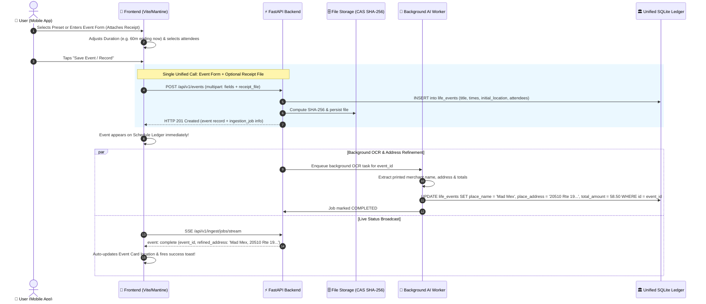

# 📡 LiftAssistant 3.0: Backend API Specification (Streamlined)

> **Target Architecture**: FastAPI (Python 3.11+) • SQLite / Grocy Engine • Asynchronous Background Workers • Server-Sent Events (SSE)  
> **Frontend Consumer**: Vite + React 18 + Mantine v7 Mobile-First Dashboard (PWA)

---

## 1. Architecture & Design Principles

The backend API is designed around five streamlined architectural pillars matching the frontend UI dashboard:

1. **The Unified Life Event & Receipt Form**: Event creation and document/receipt ingestion are unified into a single endpoint (`POST /api/v1/events`). A receipt photo can be attached directly to any event form submission.
2. **Client-Side Action Presets**: Quick action presets (Diaper Schedule, Swim Lessons, Dinner, Costco Restock) are configured on the client in TypeScript/JS; they submit directly to the unified events API without requiring backend template tables.
3. **Immediate HTTP 201/202 with Deferred AI Refinement**: Attaching a receipt never blocks event creation. The event is saved immediately with initial user context (title, attendees, start time, duration, and default location). A background worker subsequently analyzes the receipt (SHA-256 CAS), extracts printed vendor/address details, and refines the event's location on the ledger.
4. **The Confirmation Gate**: Automated inventory depletions (e.g. toddler milk burn, breakfast eggs) require explicit user approval before deducting from the Grocy stock ledger.
5. **7-Day Rolling Horizon**: Shopping list queries filter by runout runway ($S / R$). Items with $\ge 7$ days of supply are automatically excluded from active shopping queues.

---

## 2. API Endpoints Summary Matrix

| Domain / UI Component | Method | Endpoint Path | Description | Success Status |
| :--- | :--- | :--- | :--- | :--- |
| **Overview & Briefing** | `GET` | `/api/v1/overview/briefing` | Fetch weather, daily notices & summary counts | `200 OK` |
| **Conflict Triage** | `GET` | `/api/v1/conflicts` | List active scheduling and facility conflicts | `200 OK` |
| | `POST` | `/api/v1/conflicts/{id}/acknowledge` | Acknowledge & keep conflicting event | `200 OK` |
| | `POST` | `/api/v1/conflicts/{id}/reschedule` | Reschedule conflicting event to suggested slot | `200 OK` |
| **Unified Events & Ingestion** | `GET` | `/api/v1/events` | List events (filterable by category, time, status) | `200 OK` |
| | `POST` | `/api/v1/events` | **Unified Form**: Create event with optional receipt attachment | `201 Created` |
| | `GET` | `/api/v1/events/{id}` | Get event details with joined polymorphic sub-records | `200 OK` |
| | `PUT` | `/api/v1/events/{id}` | Update event details (title, times, location, notes) | `200 OK` |
| | `POST` | `/api/v1/events/{id}/receipt` | Attach / snap receipt to an existing event | `202 Accepted` |
| | `POST` | `/api/v1/events/{id}/complete` | Convert future scheduled task into completed history | `200 OK` |
| | `DELETE` | `/api/v1/events/{id}` | Delete or cancel an event | `204 No Content` |
| **Background Ingestion Feed** | `GET` | `/api/v1/ingest/jobs` | List active and historical background ingestion jobs | `200 OK` |
| | `GET` | `/api/v1/ingest/jobs/{job_id}` | Poll single ingestion job progress and results | `200 OK` |
| | `GET` | `/api/v1/ingest/jobs/stream` | SSE stream for real-time progress broadcast | `200 OK` |
| **Pantry & Fridge Pad** | `GET` | `/api/v1/inventory/products` | Fetch pantry products with burn rates & days runway | `200 OK` |
| | `POST` | `/api/v1/inventory/products/{id}/consume` | **Fridge Pad Tap**: Instantly decrement consumed units | `200 OK` |
| | `POST` | `/api/v1/inventory/products/{id}/undo-consume` | Undo accidental fridge pad tap | `200 OK` |
| | `GET` | `/api/v1/inventory/fridge-pad` | Get pinned fridge door pad tiles | `200 OK` |
| | `GET` | `/api/v1/inventory/conversions` | List bulk unit conversion map (Costco 1 pack = 36 rolls) | `200 OK` |
| | `PUT` | `/api/v1/inventory/conversions/{id}` | Update unit multiplier or receipt matching text | `200 OK` |
| | `GET` | `/api/v1/inventory/proposals` | List pending depletion proposals at Confirmation Gate | `200 OK` |
| | `POST` | `/api/v1/inventory/proposals/{id}/confirm` | Confirm depletion & deduct from stock ledger | `200 OK` |
| | `POST` | `/api/v1/inventory/proposals/{id}/dismiss` | Reject/dismiss depletion proposal | `200 OK` |
| **7-Day Shopping List** | `GET` | `/api/v1/shopping-list` | Get store-grouped items with runway < 7 days | `200 OK` |
| | `POST` | `/api/v1/shopping-list` | Manually add item to shopping list | `201 Created` |
| | `POST` | `/api/v1/shopping-list/{id}/toggle` | Check/uncheck shopping list item | `200 OK` |
| | `DELETE` | `/api/v1/shopping-list/{id}` | Remove item from shopping list | `204 No Content` |
| **Trips & Travel Engine** | `GET` | `/api/v1/trips` | List multi-stop trips with budget tracking & stops | `200 OK` |
| | `POST` | `/api/v1/trips` | Create new vacation/road trip container | `201 Created` |
| | `GET` | `/api/v1/trips/{id}/expenses` | List receipts attributed via inverted geofence | `200 OK` |

> 💡 **Client-Side Presets Note**: Family templates (Diaper Schedule, Grocery, Oil Change, Swimming) are statically defined in the client frontend (`src/mockData/index.ts`). When tapped, the UI opens the unified modal pre-filled with preset values, which submits directly to `POST /api/v1/events`.

---

## 3. Module Specifications & Data Contracts

### 3.1 Overview & Morning Briefing

#### `GET /api/v1/overview/briefing`
Returns contextual briefing information for Page 1.

**Response Schema (`200 OK`)**:
```json
{
  "date": "2026-11-09",
  "day_of_week": "Monday",
  "weather": {
    "temperature_f": 62,
    "condition": "Partly Cloudy",
    "high_f": 68,
    "low_f": 51,
    "icon": "partly-cloudy"
  },
  "notice": {
    "title": "YMCA Warm Water Pool Notice",
    "message": "Open family swim available today 1:00 PM - 3:30 PM. Lane 2 reserved for lessons.",
    "severity": "INFO",
    "action_url": null
  },
  "summary": {
    "active_conflicts_count": 2,
    "pending_depletions_count": 2,
    "active_ingestion_jobs_count": 1,
    "upcoming_events_today_count": 4
  }
}
```

---

### 3.2 Conflict Triage Center

#### `GET /api/v1/conflicts`
Fetches detected schedule collisions, travel time violations, and facility mutex conflicts.

**Response Schema (`200 OK`)**:
```json
[
  {
    "id": "cfl_01",
    "event_id": "evt_swim_101",
    "event_title": "Marcus Warm Pool Swimming Lesson",
    "conflict_type": "FACILITY_MUTEX",
    "severity": "HIGH",
    "title": "Facility Mutex Collision (Sampson YMCA)",
    "description": "Warm water pool open family swim conflicts with booked infant swim lane.",
    "suggested_action": "Reschedule swim lesson to 4:00 PM (open lane verified)",
    "suggested_new_time": "2026-11-09T16:00:00"
  },
  {
    "id": "cfl_02",
    "event_id": "evt_dentist_102",
    "event_title": "Pediatric Dental Checkup",
    "conflict_type": "TRAVEL_BUFFER",
    "severity": "MEDIUM",
    "title": "Travel Buffer Violation (18 min required)",
    "description": "Previous event ends at 1:45 PM in Wexford; Dentist begins at 1:55 PM in Cranberry.",
    "suggested_action": "Add 15m travel buffer",
    "suggested_new_time": "2026-11-09T14:10:00"
  }
]
```

#### `POST /api/v1/conflicts/{id}/acknowledge`
Dismisses the alert warning while retaining the event on schedule.

**Response Schema (`200 OK`)**:
```json
{
  "conflict_id": "cfl_01",
  "status": "ACKNOWLEDGED",
  "message": "Conflict acknowledged and retained on schedule."
}
```

#### `POST /api/v1/conflicts/{id}/reschedule`
Applies the recommended or custom rescheduled time.

**Request Payload**:
```json
{
  "new_scheduled_at": "2026-11-09T16:00:00",
  "duration_minutes": 45
}
```
**Response Schema (`200 OK`)**:
```json
{
  "conflict_id": "cfl_01",
  "event_id": "evt_swim_101",
  "status": "RESOLVED",
  "rescheduled_at": "2026-11-09T16:00:00",
  "rescheduled_end_at": "2026-11-09T16:45:00"
}
```

---

### 3.3 Unified Life Events & Receipt Ingestion Form

#### `GET /api/v1/events`
Lists all ledger entries with multi-attribute filtering.

**Query Parameters**:
- `status`: `upcoming` | `completed` | `all` (default: `all`)
- `type`: `DINING` | `SHOPPING` | `MAINTENANCE` | `KID_ACTIVITY` | `MEDICAL` | `TRAVEL` | `CUSTOM` | `ALL`
- `person`: e.g. `Marcus`
- `from`: ISO 8601 string (e.g. `2026-11-01T00:00:00Z`)
- `to`: ISO 8601 string (e.g. `2026-11-30T23:59:59Z`)

**Response Schema (`200 OK`)**:
```json
[
  {
    "id": "evt_001",
    "title": "Dinner at Mad Mex",
    "event_type": "DINING",
    "completed_at": "2026-11-08T19:45:00",
    "scheduled_at": "2026-11-08T18:30:00",
    "scheduled_end_at": "2026-11-08T19:45:00",
    "place_name": "Mad Mex",
    "place_address": "20510 Rte 19, Cranberry Twp, PA 16066",
    "people_involved": ["Dad", "Mom", "Marcus"],
    "total_amount": 58.50,
    "description": "Family dinner, great tacos",
    "dining_details": {
      "cuisine": "Mexican",
      "meal_type": "Dinner",
      "rating": 5,
      "attendees": ["Dad", "Mom", "Marcus"]
    }
  }
]
```

---

#### `POST /api/v1/events` *(Unified Event & Receipt Form)*
The core unified creation endpoint. Handles:
1. Pure manual calendar tasks (e.g. from Page 2 `[ + Add Event ]` button).
2. 1-tap quick action logs (e.g. Marcus diaper schedule).
3. Receipt & document intake (attaching receipt photo/PDF to the event form).

**Content-Type**: `multipart/form-data` (or `application/json` if no receipt file is attached)

**Form Fields**:
| Field | Type | Required | Description |
| :--- | :--- | :--- | :--- |
| `title` | `string` | Yes | Event summary (e.g. `"Dinner"`, `"My son pooped"`, `"Costco Restock"`) |
| `event_type` | `string` | Yes | `DINING` \| `SHOPPING` \| `MAINTENANCE` \| `KID_ACTIVITY` \| `MEDICAL` \| `TRAVEL` \| `CUSTOM` |
| `scheduled_at` | `string` | Yes | ISO 8601 start time (e.g. `"2026-11-09T18:30:00"`) |
| `duration_minutes` | `integer` | Yes | Duration in minutes (e.g. `15`, `30`, `45`, `60`, `90`, `120`) |
| `place_name` | `string` | No | Initial venue name (defaults to `"Current Location (Nearby)"` or `"Home"`) |
| `people_involved` | `string` (JSON) | Yes | Array of attendee names (e.g. `["Dad", "Mom", "Marcus"]`) |
| `description` | `string` | No | Free-form notes or diaper tag (`"Poop"`) |
| `receipt_file` | `binary` | **No** | Optional uploaded receipt/invoice image (`.jpg`, `.png`, `.pdf`, `.csv`) |
| `intent_details` | `string` (JSON) | No | Polymorphic metadata: <br>• **Dining**: `{"cuisine": "Mexican", "meal_type": "Dinner", "rating": 5}`<br>• **Shopping**: `{"payment_method": "Costco Citi Visa", "pantry_updated": true}`<br>• **Maintenance**: `{"equipment_name": "Honda Odyssey", "service_type": "Oil Change", "odometer_miles": 45210}`<br>• **Medical**: `{"specialty": "Pediatrician", "prescription": "Amoxicillin"}`<br>• **Kid Activity**: `{"child_name": "Marcus", "activity_type": "Swimming", "facility_studio": "Warm Pool"}` |

---

##### Case A: Event Created Without Receipt
When `receipt_file` is omitted, the event is immediately saved to the ledger.

**Response (`201 Created`)**:
```json
{
  "id": "evt_quick_1762744800",
  "title": "My son pooped",
  "event_type": "KID_ACTIVITY",
  "scheduled_at": "2026-11-09T14:00:00",
  "scheduled_end_at": "2026-11-09T14:30:00",
  "place_name": "Home (100 Main St, Cranberry Twp, PA)",
  "people_involved": ["Marcus"],
  "description": "My son pooped (Poop)",
  "created_at": "2026-11-09T14:02:15Z"
}
```

---

##### Case B: Event Created With Receipt Attached
When `receipt_file` is included:
1. The event record is created immediately on the ledger with initial location (e.g. `"Current Location (Nearby)"`).
2. The file is hashed with SHA-256 and stored in Content-Addressable Storage (CAS).
3. An asynchronous background extraction job is queued.
4. Returns `201 Created` with the new event and the background job tracker.

**Response (`201 Created`)**:
```json
{
  "event": {
    "id": "evt_snap_1762744920",
    "title": "Dinner",
    "event_type": "DINING",
    "completed_at": "2026-11-09T19:00:00",
    "scheduled_at": "2026-11-09T18:00:00",
    "scheduled_end_at": "2026-11-09T19:00:00",
    "place_name": "Current Location (Nearby)",
    "people_involved": ["Dad", "Mom", "Marcus"],
    "total_amount": 0,
    "description": "Family dinner"
  },
  "ingestion_job": {
    "job_id": "job_rec_1762744920",
    "file_hash": "sha_e3b0c44298fc1c149afbf4c8996fb92427ae41e4649b934ca495991b7852b855",
    "filename": "dining_receipt.jpg",
    "status": "PROCESSING",
    "progress_pct": 25,
    "progress_message": "Scanning receipt header: Searching printed merchant name & address..."
  }
}
```

---

#### `POST /api/v1/events/{id}/receipt`
Attach or snap a receipt to an already existing event on the ledger.

**Content-Type**: `multipart/form-data` (`file`)  
**Response (`202 Accepted`)**:
```json
{
  "event_id": "evt_001",
  "job_id": "job_rec_1762745100",
  "status": "PROCESSING",
  "progress_pct": 10,
  "progress_message": "Receipt attached. Enqueued for OCR and address verification..."
}
```

---

#### `PUT /api/v1/events/{id}`
Update event details (title, times, location, attendees, notes).

**Response (`200 OK`)**:
```json
{
  "id": "evt_001",
  "title": "Dinner at Mad Mex",
  "place_name": "Mad Mex, 20510 Rte 19, Cranberry Twp, PA",
  "total_amount": 58.50,
  "updated_at": "2026-11-09T19:05:00Z"
}
```

#### `POST /api/v1/events/{id}/complete`
Converts an upcoming scheduled task into a completed historical footprint.

**Response (`200 OK`)**:
```json
{
  "id": "evt_001",
  "completed_at": "2026-11-09T19:00:00Z",
  "status": "COMPLETED"
}
```

#### `DELETE /api/v1/events/{id}`
Removes an event from the ledger (`204 No Content`).

---

### 3.4 Background Ingestion Feed & SSE Updates

#### `GET /api/v1/ingest/jobs`
Lists active and recent receipt background processing jobs.

**Response Schema (`200 OK`)**:
```json
[
  {
    "job_id": "job_rec_1762744920",
    "event_id": "evt_snap_1762744920",
    "filename": "dining_receipt.jpg",
    "file_hash": "sha_e3b0c442...",
    "status": "PROCESSING",
    "progress_pct": 65,
    "progress_message": "Parsing line items and sales tax totals...",
    "created_at": "2026-11-09T19:00:05Z"
  }
]
```

#### `GET /api/v1/ingest/jobs/{job_id}`
Polls status and extraction results for a specific ingestion job.

**Response Schema (`200 OK`)**:
```json
{
  "job_id": "job_rec_1762744920",
  "event_id": "evt_snap_1762744920",
  "status": "COMPLETED",
  "progress_pct": 100,
  "progress_message": "Complete! Address verified & written to ledger.",
  "result": {
    "merchant_name": "Mad Mex Cantina",
    "verified_address": "Mad Mex, 20510 Rte 19, Cranberry Twp, PA 16066",
    "total_amount": 58.50,
    "transaction_time": "2026-11-09T18:42:00",
    "line_items_count": 4
  }
}
```

#### `GET /api/v1/ingest/jobs/stream`
Server-Sent Events (SSE) stream for real-time progress broadcast. When complete, the client automatically updates the event card's location and displays a toast notification.

```
event: progress
data: {"job_id": "job_rec_1762744920", "progress_pct": 70, "progress_message": "Extracting merchant address..."}

event: complete
data: {"job_id": "job_rec_1762744920", "event_id": "evt_snap_1762744920", "refined_address": "Mad Mex, 20510 Rte 19, Cranberry Twp, PA", "total": 58.50}
```

---

### 3.5 Inventory Ledger & The Confirmation Gate

#### `GET /api/v1/inventory/proposals`
Lists pending depletion proposals waiting at the Confirmation Gate.

**Response Schema (`200 OK`)**:
```json
[
  {
    "id": "dep_01",
    "product_name": "Kirkland Organic Whole Milk",
    "proposed_amount": 0.5,
    "unit": "gal",
    "current_stock": 2.0,
    "remaining_stock": 1.5,
    "reason": "Estimated daily toddler consumption (Marcus)",
    "confidence_score": 0.92
  },
  {
    "id": "dep_02",
    "product_name": "Pasture-Raised Eggs",
    "proposed_amount": 6,
    "unit": "eggs",
    "current_stock": 18,
    "remaining_stock": 12,
    "reason": "Weekend family breakfast recipe",
    "confidence_score": 0.88
  }
]
```

#### `POST /api/v1/inventory/proposals/{id}/confirm`
Executes stock reduction in the Grocy inventory ledger.

**Response Schema (`200 OK`)**:
```json
{
  "proposal_id": "dep_01",
  "product_name": "Kirkland Organic Whole Milk",
  "status": "DEDUCTED",
  "new_stock": 1.5,
  "unit": "gal",
  "transaction_id": "tx_grocy_84920"
}
```

#### `POST /api/v1/inventory/proposals/{id}/dismiss`
Dismisses the proposed depletion without modifying stock.

**Response Schema (`200 OK`)**:
```json
{
  "proposal_id": "dep_01",
  "status": "DISMISSED"
}
```

#### `GET /api/v1/inventory/products`
Retrieves all tracked pantry products and burn rate runway.

**Response Schema (`200 OK`)**:
```json
[
  {
    "id": "prod_tp",
    "name": "Kirkland Bath Tissue (Toilet Paper)",
    "current_stock": 14,
    "unit": "rolls",
    "purchase_unit": "pack (36 rolls)",
    "unit_multiplier": 36,
    "consume_step": 1,
    "consume_step_label": "-1 Roll",
    "daily_burn_rate": 1.2,
    "days_runway": 11.6,
    "store_name": "Costco",
    "location": "Master Bath Closet",
    "is_fridge_quick_tile": true
  },
  {
    "id": "prod_01",
    "name": "Kirkland Organic Whole Milk",
    "current_stock": 1.2,
    "unit": "gal",
    "purchase_unit": "twin pack (2 gal)",
    "unit_multiplier": 2,
    "consume_step": 0.5,
    "consume_step_label": "-0.5 Gal",
    "burn_rate_daily": 0.15,
    "days_runway": 8.0,
    "store_name": "Costco",
    "location": "Kitchen Refrigerator",
    "is_fridge_quick_tile": true
  }
]
```

---

#### `POST /api/v1/inventory/products/{id}/consume` *(Fridge Door Pad Tap)*
Ultra-fast, low-latency endpoint invoked when a user taps a tile on the fridge-door mounted tablet to record consumed items.

**Request Payload**:
```json
{
  "amount": 1.0,
  "source": "FRIDGE_PAD"
}
```

**Response Schema (`200 OK`)**:
```json
{
  "product_id": "prod_tp",
  "name": "Kirkland Bath Tissue (Toilet Paper)",
  "previous_stock": 14,
  "amount_consumed": 1.0,
  "current_stock": 13.0,
  "unit": "rolls",
  "daily_burn_rate": 1.2,
  "days_runway": 10.8,
  "is_low_stock": false,
  "queued_to_shopping_list": false,
  "message": "Recorded: 1 roll consumed. 13 rolls remaining (10.8d runway).",
  "undo_token": "undo_consume_98412"
}
```

---

#### `POST /api/v1/inventory/products/{id}/undo-consume`
Reverses an accidental tap on the fridge door tablet.

**Request Payload**:
```json
{
  "undo_token": "undo_consume_98412"
}
```
**Response Schema (`200 OK`)**:
```json
{
  "product_id": "prod_tp",
  "restored_stock": 14.0,
  "unit": "rolls",
  "status": "RESTORED"
}
```

---

#### `GET /api/v1/inventory/conversions` *(Bulk Purchase Unit Multiplier Map)*
Returns the conversion table used by the receipt ingestion worker to automatically expand bulk store packages into discrete consumption units.

**Response Schema (`200 OK`)**:
```json
[
  {
    "id": "conv_01",
    "product_id": "prod_tp",
    "product_name": "Kirkland Bath Tissue (Toilet Paper)",
    "store_name": "Costco",
    "receipt_raw_text": "KS BATH TISSUE 36/PK #1500",
    "purchase_unit": "pack",
    "stock_unit": "rolls",
    "unit_multiplier": 36
  },
  {
    "id": "conv_02",
    "product_id": "prod_01",
    "product_name": "Whole Milk",
    "store_name": "Costco",
    "receipt_raw_text": "KS ORG WHOLE MILK 2/1GAL",
    "purchase_unit": "twin-pack",
    "stock_unit": "gal",
    "unit_multiplier": 2
  },
  {
    "id": "conv_03",
    "product_id": "prod_02",
    "product_name": "Large Brown Eggs",
    "store_name": "Costco",
    "receipt_raw_text": "KS ORG BROWN EGGS 2/24",
    "purchase_unit": "case",
    "stock_unit": "eggs",
    "unit_multiplier": 48
  },
  {
    "id": "conv_04",
    "product_id": "prod_05",
    "product_name": "Cascade Platinum Dishwasher Pods",
    "store_name": "Costco",
    "receipt_raw_text": "CASCADE PLAT 90CT TUB",
    "purchase_unit": "tub",
    "stock_unit": "pods",
    "unit_multiplier": 90
  }
]
```

> ⚙️ **Automatic Receipt Multiplication Rule**:
> When a Costco receipt item is extracted:
> $$\text{Stock Units Added} = \text{Receipt Line Quantity} \times \text{unit\_multiplier}$$
> *Example:* Buying **1 pack** of `KS BATH TISSUE 36/PK` on a Costco receipt adds **+36 rolls** to the inventory stock ledger. Tapping the fridge door pad decrements **-1 roll** at a time!

---

### 3.6 7-Day Rolling Horizon Shopping List

#### `GET /api/v1/shopping-list`
Computes the dynamic shopping list. Items with $\ge 7$ days of supply ($S / R \ge 7$) are automatically suppressed.

**Response Schema (`200 OK`)**:
```json
{
  "horizon_days": 7,
  "hidden_sufficient_items": [
    { "id": "prod_01", "name": "Kirkland Organic Whole Milk", "days_runway": 8.0 },
    { "id": "prod_02", "name": "Pasture-Raised Eggs", "days_runway": 9.0 }
  ],
  "queued_items": [
    {
      "id": "shop_01",
      "product_id": "prod_03",
      "item_name": "Organic Honeycrisp Apples",
      "store_name": "Trader Joe's",
      "amount": 3,
      "unit": "lbs",
      "days_runway": 2.0,
      "checked": false
    },
    {
      "id": "shop_02",
      "product_id": "prod_04",
      "item_name": "Cascade Platinum Dishwasher Pods",
      "store_name": "Costco",
      "amount": 1,
      "unit": "tub (90 count)",
      "days_runway": 4.5,
      "checked": false
    }
  ]
}
```

#### `POST /api/v1/shopping-list/{id}/toggle`
Toggles item checked status.

**Response Schema (`200 OK`)**:
```json
{
  "id": "shop_01",
  "checked": true,
  "updated_at": "2026-11-09T14:10:00Z"
}
```

---

### 3.7 Travel & Multi-Stop Trips Engine

#### `GET /api/v1/trips`
Retrieves active and planned vacations, budget burn, and geofence-attributed stops.

**Response Schema (`200 OK`)**:
```json
[
  {
    "id": "trip_disney_2026",
    "name": "Disney World Family Road Trip",
    "start_date": "2026-11-18",
    "end_date": "2026-11-25",
    "budget": 3500,
    "spent": 1420,
    "geofence_center_lat": 40.6873,
    "geofence_center_lng": -80.1078,
    "inverted_geofence_radius_miles": 30.0,
    "stops": [
      {
        "name": "Buc-ee's Florence, SC (Fuel & Snacks)",
        "date": "Nov 18, 2026",
        "category": "Fuel / Rest Stop",
        "amount": 68.40
      },
      {
        "name": "Disney Coronado Springs Resort",
        "date": "Nov 19 - Nov 24, 2026",
        "category": "Lodging",
        "amount": 1150.00
      }
    ]
  }
]
```

---

## 4. Sequence Diagram: Unified Event & Receipt Intake



---

## 5. Standard Error Responses

```json
{
  "error": {
    "code": "EVENT_CONFLICT_DETECTED",
    "message": "The proposed event time overlaps with an existing non-preemptible facility booking.",
    "status": 409,
    "timestamp": "2026-11-09T14:15:00Z",
    "details": {
      "conflicting_event_id": "evt_swim_101",
      "conflict_type": "FACILITY_MUTEX"
    }
  }
}
```
