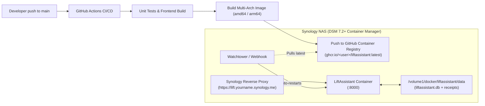

# 🐳 LifeAssistant: Dockerization & Synology NAS Deployment Guide

This guide walks through containerizing LifeAssistant and setting up automated Continuous Integration & Continuous Deployment (CI/CD) to **Synology NAS (Container Manager / Docker)**.

---

## 🏗️ Architecture Overview

LiftAssistant runs as a **single, unified, production container**:
- **Frontend**: Vite + React 18 + Mantine PWA compiled into static assets and served by the ASGI server.
- **Backend**: FastAPI REST API on port `8000` (`/api/v1/*`), background daily workers, and SQLite engine.
- **Persistent Storage**: Mapped to Synology NAS persistent volume (`/volume1/docker/liftassistant/data`), holding `liftassistant.db` and CAS receipts (`receipt_store/`).



---

## 🚀 Part 1: Automated CI/CD (GitHub Actions)

The repository includes a ready-to-run GitHub Actions workflow at [`.github/workflows/ci-cd.yml`](file:///c:/Users/nickr/OneDrive/文档/Github/liftassistant/.github/workflows/ci-cd.yml):

1. **Test Stage**:
   - Executes Python backend unit tests (`python -m unittest discover -s tests -p "test_*.py"`).
   - Builds the production React PWA (`npm run build`).
2. **Build & Publish Stage**:
   - Builds multi-architecture images (`linux/amd64` for Intel/AMD Synology models like DS920+, DS1520+, DS923+, DS1621+, and `linux/arm64` for ARM models).
   - Pushes automatically to **GitHub Container Registry** (`ghcr.io/<your-github-username>/liftassistant:latest`).

### Making the Package Public (Simplest Setup)
By default, GitHub packages from public repos are public. If your repo is private:
1. Go to your GitHub profile $\to$ **Packages** $\to$ `liftassistant`.
2. Click **Package settings** $\to$ change visibility to **Public** (or see below for private authentication on Synology).

---

## 📦 Part 2: Synology NAS Setup (Container Manager)

### Step 1: Create Shared Folders on Synology DSM
1. Open **File Station** in Synology DSM.
2. In the `docker` share, create a folder named `liftassistant`:
   - Path: `/volume1/docker/liftassistant`
3. Inside `liftassistant`, create a subfolder named `data`:
   - Path: `/volume1/docker/liftassistant/data`
4. *(Optional Migration)*: If you want to carry over your existing SQLite database and receipts, copy your local `data/liftassistant.db` and `data/receipt_store/` into this `data/` folder.

---

### Step 2: (Private Repos Only) Add Registry Credential in Synology
*If your container package is Public on GHCR, skip to Step 3.*

If private:
1. On GitHub: Go to **Settings** $\to$ **Developer Settings** $\to$ **Personal access tokens** $\to$ **Tokens (classic)**.
2. Generate a token with `read:packages` scope.
3. On Synology DSM: Open **Container Manager** $\to$ **Registry** $\to$ **Add**.
   - **Registry Name**: `GitHub Container Registry`
   - **Registry URL**: `ghcr.io`
   - **Username**: Your GitHub username
   - **Password**: Your GitHub Personal Access Token (PAT)

---

### Step 3: Deploy via Container Manager "Project" (Docker Compose)

1. Open **Container Manager** on DSM.
2. Navigate to **Project** in the left sidebar $\to$ Click **Create**.
3. Configure the Project:
   - **Project Name**: `lifeassistant`
   - **Path**: Choose `/volume1/docker/lifeassistant`
   - **Source**: Select **Create docker-compose.yml**
4. Paste the following configuration:

```yaml
version: "3.8"

services:
  lifeassistant:
    image: ghcr.io/hansololai/liftassistant:latest
    container_name: lifeassistant
    restart: unless-stopped
    ports:
      - "8000:8000"
    volumes:
      - /volume1/docker/lifeassistant/data:/app/data
    environment:
      - ENVIRONMENT=prod
      - LLM_PROVIDER=ollama
      - LLM_BASE_URL=http://host.docker.internal:11434
      - LLM_MODEL=ollama/deepseek-r1:14b
      - TZ=America/New_York
    healthcheck:
      test: ["CMD", "curl", "-f", "http://127.0.0.1:8000/api/v1/health"]
      interval: 30s
      timeout: 5s
      retries: 3
      start_period: 15s
    extra_hosts:
      - "host.docker.internal:host-gateway"

  # Optional: Zero-touch auto-updates via Watchtower
  watchtower:
    image: containrrr/watchtower
    container_name: watchtower-lifeassistant
    restart: unless-stopped
    volumes:
      - /var/run/docker.sock:/var/run/docker.sock
    environment:
      - WATCHTOWER_CLEANUP=true
      - WATCHTOWER_POLL_INTERVAL=21600 # Checks every 6 hours
    command: lifeassistant
```

5. Click **Next** $\to$ Click **Done**.
   Container Manager will pull the image and start both services.

---

## 🔄 Part 3: Automated Continuous Deployment (Two Methods)

### Method A: Automated Watchtower (Zero-Touch - Recommended)
The `watchtower` companion service in the docker-compose file above monitors `ghcr.io/<YOUR_GITHUB_USERNAME>/liftassistant:latest`:
- Whenever your GitHub Actions pipeline builds and pushes a new commit to `main`, Watchtower detects the new image hash on GHCR.
- It automatically pulls the new image, gracefully stops the running container, and starts the new container with the exact same data volumes and environment variables intact.
- **No port forwards or inbound SSH keys required on your home network.**

### Method B: DSM Webhook / Task Scheduler (Instant Push)
If you prefer an instant trigger when CI finishes:
1. In Synology DSM: **Control Panel** $\to$ **Task Scheduler** $\to$ **Create** $\to$ **Triggered Task** $\to$ **User-defined script**.
2. Event: **Boot-up** or run via script:
   ```bash
   cd /volume1/docker/liftassistant
   docker compose pull liftassistant
   docker compose up -d liftassistant
   ```

---

## 🔒 Part 4: Synology HTTPS Reverse Proxy & PWA

To access LiftAssistant securely outside your home network and install it as an iPhone/Android PWA:

1. In DSM: **Control Panel** $\to$ **Login Portal** $\to$ **Advanced** $\to$ **Reverse Proxy** $\to$ **Create**.
2. **General Tab**:
   - **Reverse Proxy Name**: `LiftAssistant`
   - **Source**:
     - Protocol: `HTTPS`
     - Hostname: `lift.yourfamily.synology.me` (or custom domain)
     - Port: `443`
     - Enable HSTS: Checked
   - **Destination**:
     - Protocol: `HTTP`
     - Hostname: `localhost`
     - Port: `8000`
3. **Custom Header Tab**:
   - Click **Create** $\to$ **WebSocket** (adds `Upgrade` and `Connection` headers for real-time SSE updates).
4. Click **Save**.
5. Visit `https://lift.yourfamily.synology.me` on Safari (iOS) or Chrome (Android) $\to$ Tap **Share** $\to$ **Add to Home Screen** to install the PWA.

---

## 📱 Part 5: Family Device Enrollment (Magic Links)

LiftAssistant uses zero-password, cryptographic device authorization. Each physical phone or tablet holds a 10-year session token.

### 1. Enrolling Your First Device (Day 1)
When the container starts up for the first time, it automatically creates pre-seeded pending devices for **Dad's Phone** and **Mom's Phone**.

You can get your initial magic link in either of two ways:
- **Option A (Container Manager Log)**:
  In Synology DSM $\to$ **Container Manager** $\to$ **Containers** $\to$ click `liftassistant` $\to$ **Log**.
  You will see the enrollment banner:
  ```text
  🎉 [LiftAssistant First-Run Device Enrollment Links]
    📱 Dad's Phone: /?enroll_token=dad_enroll_...
    📱 Mom's Phone: /?enroll_token=mom_enroll_...
  ```
- **Option B (Terminal CLI)**:
  Run in SSH or DSM terminal:
  ```bash
  docker exec liftassistant python -m liftassistant devices
  ```

Open the link on your phone (e.g. `https://lift.yourdomain.synology.me/?enroll_token=dad_enroll_...`).
Your phone is now permanently authorized!

---

### 2. Enrolling Additional Devices (Mom, Kids, iPad)
Once any device is authorized, you **never** need the terminal again:
1. In the top navigation bar of the LiftAssistant web app, tap the **Key / Mobile icon** (**Manage Authorized Family Devices**).
2. Tap **+ Add Device** and type a name (e.g., `Mom's iPhone` or `Marcus's iPad`).
3. Tap **Copy Magic Enrollment Link**.
4. Send the link via iMessage, WhatsApp, or AirDrop.
5. When opened on the other device, it authorizes instantly and prompts **Add to Home Screen**.
