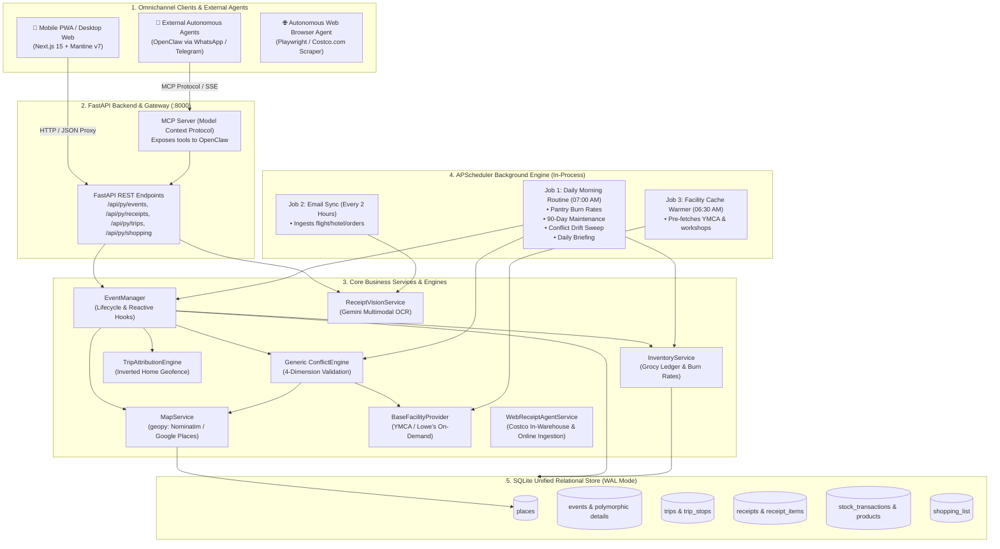
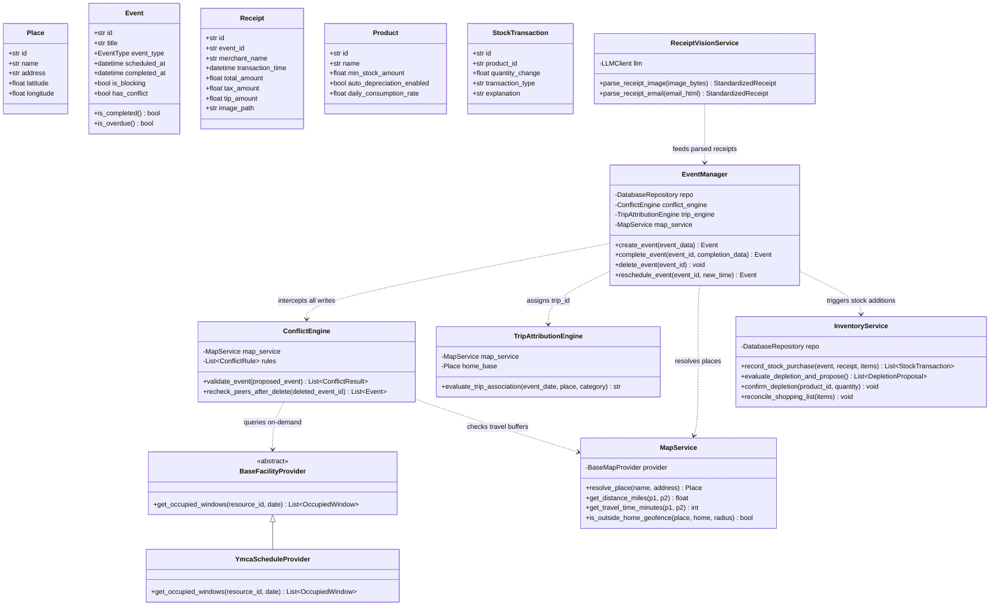
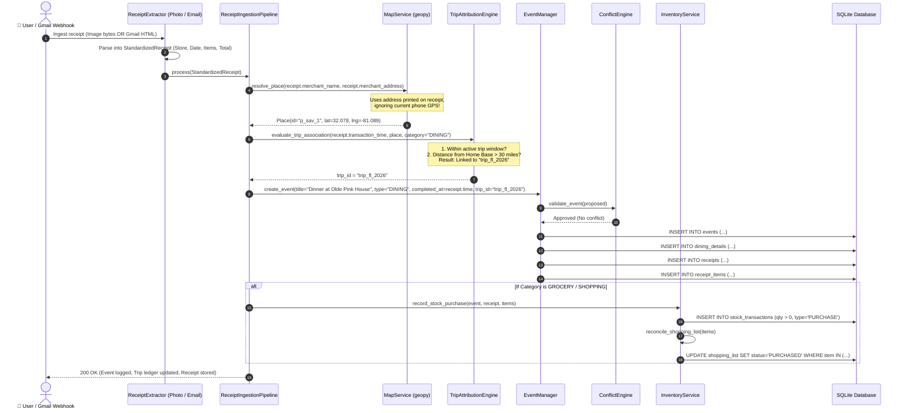

# 🏛️ LiftAssistant 3.0: Personal Life OS & Intelligent Digital Ledger
## Comprehensive Architectural Specification & System Design

**Version:** 3.0  
**Status:** Approved / Specification Baseline  
**Last Updated:** November 2026  

---

## 1. Executive Summary & Paradigm Shift

### From Script Runner to Personal Life Operating System
LiftAssistant 1.0/2.0 began as a script-based automation tool and agent prototype. **LiftAssistant 3.0 evolves into a comprehensive Personal Life Operating System and Intelligent Digital Ledger**. 

It unifies daily household logistics, personal financial records, family scheduling, pantry inventory, and travel into a single cohesive architecture.

### Core Architectural Tenets
1. **The Unified Lifecycle Event Continuum**: Life is not divided into artificial silos of "tasks to-do" vs. "past diary notes" vs. "receipt expenses". Every life event (dining, shopping, swimming lessons, oil changes, flight reservations) lives on the exact same continuum, governed by two timestamps: `scheduled_at` (planning) and `completed_at` (fulfillment).
2. **First-Class Places & Relational Integrity**: Locations are not unnormalized text strings. They are first-class `places` enriched by Map APIs, linking events, stores, inventory, and travel stops. Type-specific attributes use **Joined-Table Relational Polymorphism** with strict foreign keys.
3. **Code for Determinism, LLMs for Perception & Ambiguity**: Deterministic logic (date math, calendar overlaps, SQL queries, facility schedule API calls) runs in pure Python for zero cost and microsecond latency. LLMs are reserved strictly for multimodal perception (folded receipt photos, messy email HTML) and semantic contextual reasoning.
4. **The Anti-Fatigue Principle (Smart Grocy)**: Adopt Grocy's brilliant inventory concepts (storage locations, quantity units, reorder thresholds) while eliminating its fatal flaw—manual data entry fatigue—by using receipt vision scanning, automated consumption rate calculation, and explicit user confirmation gates.
5. **Mobile-First All-in-One Experience**: A modern, thumb-friendly dashboard using **Mantine v7** and **Next.js** connected to a Python **FastAPI** backend via reverse proxy, enabling 1-tap smartphone camera receipt capture and offline PWA installation.
6. **Generic, Multi-Dimensional Conflict Engine**: Replaces ad-hoc facility checks with a universal, 4-dimensional conflict engine that guards against resource occupancy, person double-booking, transit logistics, and family blackout rules.

---

## 2. High-Level System Architecture



---

## 3. Enhanced Entity-Relationship (EER) Architecture Diagram

```mermaid
erDiagram
    %% ====================================================================
    %% 1. PLACES & GEOGRAPHIC ANCHOR
    %% ====================================================================
    PLACES ||--o{ EVENTS : "hosted at"
    PLACES ||--o{ RECEIPTS : "merchant venue"
    PLACES ||--o{ PRODUCTS : "default store for"
    PLACES ||--o{ SHOPPING_LIST : "target store for"
    PLACES ||--o{ TRIPS : "destination of"
    PLACES ||--o{ TRIP_STOPS : "stop location"
    PLACES ||--o{ RESOURCES : "contains"

    PLACES {
        string id PK
        string name "Rose E. Schneider YMCA, Mad Mex, Costco"
        string category "restaurant, supermarket, gym, school, hotel"
        string address "Full formatted street address"
        float latitude
        float longitude
        string google_place_id
        string map_url "Direct navigation link"
        string notes "Parking tips, entrance info"
    }

    RESOURCES {
        string id PK
        string place_id FK
        string name "Warm Water Pool, Workshop Room"
        string category "pool_studio, workshop_room"
        integer capacity
    }

    PEOPLE {
        string id PK
        string name "Dad, Mom, Marcus"
        string role "parent, child"
    }

    %% ====================================================================
    %% 2. TRAVEL & TRIPS DOMAIN
    %% ====================================================================
    TRIPS ||--o{ TRIP_STOPS : "contains (1-to-Many)"
    TRIPS ||--o{ EVENTS : "groups (1-to-Many)"

    TRIPS {
        string id PK
        string name "Disney World 2026, Tokyo Trip"
        string destination_place_id FK
        timestamp start_date
        timestamp end_date
        float budget "Spending target"
        string currency "USD, EUR, JPY"
        string status "PLANNED, ACTIVE, COMPLETED"
        string notes
    }

    TRIP_STOPS {
        string id PK
        string trip_id FK
        string place_id FK
        string stop_name "Tokyo, Kyoto, Savannah GA"
        date arrival_date
        date departure_date
        integer stop_order
    }

    %% ====================================================================
    %% 3. UNIFIED EVENT LIFECYCLE & POLYMORPHIC EXTENSIONS
    %% ====================================================================
    EVENTS ||--o| DINING_DETAILS : "specializes (1:1)"
    EVENTS ||--o| SHOPPING_DETAILS : "specializes (1:1)"
    EVENTS ||--o| MAINTENANCE_DETAILS : "specializes (1:1)"
    EVENTS ||--o| KID_ACTIVITY_DETAILS : "specializes (1:1)"
    EVENTS ||--o{ RECEIPTS : "contains (1-to-Many)"
    EVENTS ||--o{ STOCK_TRANSACTIONS : "purchased via"

    EVENTS {
        string id PK
        string trip_id FK "Nullable: links to trip"
        string place_id FK "Primary venue"
        string resource_id FK "Nullable: facility required"
        string person_id FK "Nullable: child/parent required"
        string title "Dinner at Mad Mex, Warm Pool Lesson"
        string event_type "DINING, SHOPPING, MAINTENANCE, KID_ACTIVITY, TRAVEL, GENERIC"
        timestamp scheduled_at "Planned time (NULL if spontaneous log)"
        timestamp completed_at "Fulfilled time (NULL if upcoming task)"
        boolean all_day
        boolean is_blocking "TRUE blocks personal calendar"
        float total_amount "Sum of receipts / costs"
        string notes
        string source "MANUAL, RECEIPT_OCR, AGENT_GMAIL, AGENT_YMCA"
        string source_reference_id
        boolean has_conflict "TRUE if clash detected"
        string conflict_status "DETECTED, ACKNOWLEDGED, RESOLVED"
        string conflict_reason "Human-readable explanation"
        string conflicting_event_id FK "Points to peer event if overlap"
    }

    DINING_DETAILS {
        string event_id PK,FK
        string cuisine "Mexican, Italian, Sushi"
        string meal_type "breakfast, lunch, dinner, drinks"
        integer rating "1 to 5 stars"
        string attendees "JSON list: Family, Alex"
    }

    SHOPPING_DETAILS {
        string event_id PK,FK
        string payment_method "Chase Sapphire, Apple Pay"
        boolean pantry_updated
    }

    HOUSEHOLD_EQUIPMENT ||--o{ MAINTENANCE_DETAILS : "serviced in"
    HOUSEHOLD_EQUIPMENT {
        string id PK
        string name "Honda Odyssey, Kitchen Fridge"
        string category "vehicle, appliance, hvac"
        string model_number
        string serial_number
        date warranty_expiry
    }

    MAINTENANCE_DETAILS {
        string event_id PK,FK
        string equipment_id FK
        integer odometer_miles
        string service_type "oil_change, filter_replace"
        integer next_due_interval_days
        integer next_due_miles
    }

    KID_ACTIVITY_DETAILS {
        string event_id PK,FK
        string child_name "Marcus"
        string activity_type "swimming, soccer, piano"
        string facility_studio "Warm Water Pool"
        string instructor
    }

    %% ====================================================================
    %% 4. FINANCIAL RECEIPTS & AUDIT LEDGER
    %% ====================================================================
    RECEIPTS ||--o{ RECEIPT_ITEMS : "itemized on (1-to-Many)"
    RECEIPTS ||--o{ STOCK_TRANSACTIONS : "sources stock additions"

    RECEIPTS {
        string id PK
        string event_id FK "Links receipt to parent Event"
        string place_id FK "Merchant venue"
        string file_hash "SHA-256 hash for CAS deduplication"
        string file_path "Path: data/receipt_store/YYYY-MM/{hash}.pdf"
        string original_filename "Original uploaded/downloaded filename"
        string mime_type "application/pdf, image/jpeg, text/csv, application/json"
        string merchant_name "Printed store name"
        string merchant_address "Printed address on paper"
        timestamp transaction_time "Printed date and time"
        float subtotal
        float tax_amount
        float tip_amount "Dining tips"
        float total_amount "Final charge"
        string currency "USD, EUR, JPY"
        string payment_method
        string source_channel "PHOTO_CAMERA, GMAIL_BODY, PDF_INVOICE, FOLDER_DROPZONE"
        string source_reference_id "Gmail msg_id or filename"
        string raw_ocr_json "Audit trail of raw OCR text"
        string parsing_status "SUCCESS, FAILED, NEEDS_REVIEW"
        string parsing_error "Error stack trace if failed (enables retry)"
    }

    RECEIPT_ITEMS {
        string id PK
        string receipt_id FK
        string product_id FK "Nullable: links to master product"
        string raw_text "Raw line from receipt OCR"
        string clean_name "Standardized name"
        string category "produce, dairy, meat, household"
        float quantity
        string unit "ea, lb, pack"
        float unit_price
        float total_price
    }

    %% ====================================================================
    %% 5. GROCY INVENTORY & SMART SHOPPING LIST
    %% ====================================================================
    STORAGE_LOCATIONS ||--o{ PRODUCTS : "default storage for"
    STORAGE_LOCATIONS ||--o{ STOCK_TRANSACTIONS : "location"
    STORAGE_LOCATIONS {
        string id PK
        string name "Kitchen Fridge, Pantry, Freezer, Basement"
        string description
    }

    QUANTITY_UNITS ||--o{ PRODUCTS : "purchased in"
    QUANTITY_UNITS ||--o{ PRODUCTS : "tracked in"
    QUANTITY_UNITS ||--o{ STOCK_TRANSACTIONS : "unit"
    QUANTITY_UNITS ||--o{ SHOPPING_LIST : "unit"
    QUANTITY_UNITS {
        string id PK
        string name "piece, pack, can, gallon, lb, box"
        string name_plural
    }

    PRODUCTS ||--o{ STOCK_TRANSACTIONS : "movements of"
    PRODUCTS ||--o{ SHOPPING_LIST : "replenished on"
    PRODUCTS {
        string id PK
        string name "Whole Milk, Paper Towels"
        string category "produce, dairy, household"
        string default_location_id FK
        string default_place_id FK "e.g. Costco"
        string qu_purchase_id FK "e.g. Pack"
        string qu_stock_id FK "e.g. Can"
        float qu_factor "1 pack = 12 cans"
        float min_stock_amount "Auto-reorder threshold"
        integer default_best_before_days
        boolean auto_depreciation_enabled "Default FALSE"
        float daily_consumption_rate "Computed burn rate"
    }

    STOCK_TRANSACTIONS {
        string id PK
        string product_id FK
        float quantity_change "Positive for +, Negative for -"
        string quantity_unit_id FK
        string transaction_type "PURCHASE, AUTO_DEPRECIATION, MANUAL, SPOILED"
        string event_id FK "Mandatory link to Shopping Event"
        string receipt_id FK "Optional link to receipt"
        string explanation "Auto-depreciation 6-day cycle, etc."
        string location_id FK
        timestamp created_at
    }

    SHOPPING_LIST {
        string id PK
        string product_id FK "Nullable: allows ad-hoc items"
        string item_name
        float amount
        string qu_id FK
        string target_place_id FK "Store grouping (Costco tab)"
        string status "PENDING, IN_CART, PURCHASED"
        string source "MANUAL, MIN_STOCK_TRIGGER, AI_ESTIMATE"
    }
```



---

## 4. Object-Oriented Class Interaction Architecture



---

## 5. Runtime Interaction Sequence: Omnichannel Receipt Ingestion

This sequence traces the exact flow when a receipt is ingested (via mobile camera photo OR incoming Gmail body) while away on a multi-stop vacation:



---

## 6. Subsystem Specifications

### 6.1. The Unified Lifecycle Event Engine (`events`)
- **No artificial `temporal_type`**: All events are governed strictly by:
  - `scheduled_at` (Optional): When the event is planned or expected to occur.
  - `completed_at` (Optional): When the event actually occurred or was fulfilled.
- **State Derivations**:
  - `completed_at IS NULL AND scheduled_at > NOW()` $\longrightarrow$ **Upcoming Future Task / Plan**.
  - `completed_at IS NULL AND scheduled_at <= NOW()` $\longrightarrow$ **Overdue / Due Now**.
  - `completed_at IS NOT NULL` $\longrightarrow$ **Completed Historical Record**.
- **Bidirectional Bridge**:
  - Completing a task allows attaching actual costs, photos, or receipts, converting it into a historical record.
  - Logging a past maintenance event (e.g. replacing a fridge filter today) spawns a future task (`scheduled_at = TODAY + 6 months`).

### 6.2. First-Class Places & Map API (`places`)
- **Abstracted Provider**: Implemented via `geopy` behind `BaseMapProvider`.
  - **Default**: OpenStreetMap (`Nominatim`) — 100% free, zero API key required.
  - **Commercial Upgrade**: Google Places API (`GoogleV3`) or Mapbox via `.env` toggle (`MAP_PROVIDER="google"`).
- **Asynchronous Ingestion Rule**: When processing receipts, the **physical address printed on the receipt header is the absolute ground truth**. The device's live GPS is strictly ignored during receipt processing to prevent false attributions when scanning vacation receipts from home.

### 6.3. Travel & Multi-Stop Trips Engine (`trips`, `trip_stops`)
- **The Inverted Home Geofence**:
  - Fixed-radius destination circles fail on multi-stop road trips across several states.
  - Instead, the system checks distance from **Home Base**: if a physical merchant swipe or dining receipt happens **$> 30$ miles outside Home Base during the trip date window**, it is automatically linked to the trip ledger.
- **Non-Trip Expense Filter**:
  - `BILL_ADMIN`, `UTILITIES`, and `HOME_MAINTENANCE` (e.g. electric bills, home lawn mowing) occurring during trip dates are strictly excluded from the trip ledger via category rules.
- **Ordered Itineraries**: `trip_stops` allows grouping vacation expenses and timelines by city (e.g. *Stop 1: Savannah, GA (\$420)* $\to$ *Stop 2: Orlando, FL (\$1,850)*).

### 6.4. Grocy-Inspired Stock Ledger (`stock_transactions`)
- **Double-Entry Mathematical Guarantee**:
  - Current stock is never an unmanaged mutable number. It is mathematically guaranteed by the SQLite database engine via a View (`v_product_stock`) or an automated **SQLite Trigger**:
    $$\text{current\_quantity} = \sum \text{stock\_transactions.quantity\_change}$$
- **Additions (+)**: Every addition is strictly anchored to a `Shopping Event` (`event_id`), supporting both receipt uploads and receipt-less manual cash runs.
- **Subtractions (-)**: Every deduction is categorized (`AUTO_DEPRECIATION`, `MANUAL_CONSUMPTION`, `SPOILED_DISCARD`, `INVENTORY_CORRECTION`).
- **The User Confirmation Gate**:
  - Auto-depreciation starts as **`auto_depreciation_enabled = FALSE`** by default.
  - The system learns consumption rates from purchase cadence (e.g. 1 gal milk / 6 days = 0.17 gal/day).
  - Proposed depletions enter a **Pending Review Queue** on the mobile UI: you tap **Confirm** before deductions are written to the ledger.

### 6.5. Generic Rule-Based Conflict Engine (`ConflictEngine`)
- **The 4 Dimensions Evaluated**:
  1. *Resource Mutex*: Target facility or room is occupied by an external class or maintenance.
  2. *Person Overlap*: Target child or parent has an overlapping commitment.
  3. *Travel Buffer*: Insufficient driving time between consecutive places based on Map API driving distance.
  4. *Family Policies*: Blackouts (e.g. no kid activities after 7:30 PM on school nights).
- **Non-Polluting Resource Providers (`BaseFacilityProvider`)**:
  - Facility schedules (YMCA pool classes, Lowe's workshops) are queried **on-demand** with a 4-hour memory cache. Your personal calendar is **never flooded with 100 unused fitness classes**.
- **Soft-Conflict Tolerance**:
  - Confirmed real-world bookings (e.g. booked outside the app, confirmed via email) are **never hard-rejected**. They are saved with `has_conflict = TRUE`, `conflict_status = 'DETECTED'`, and clear reasons, accompanied by 1-click `[ Reschedule ]` or `[ Acknowledge ]` actions.
- **Instant Reactive Resolution**:
  - When an event is deleted or moved, an instant reactive hook (`on_event_deleted`) re-evaluates affected peers in **`< 2 milliseconds`**, clearing conflict warnings immediately in the UI.

### 6.6. Local Folder Dropzone & Multi-Format Ingestion (`FolderReceiptWatcher`)
- **Supported File Formats**:
  - **Images**: `.jpg`, `.jpeg`, `.png`, `.webp`, `.heic` (Paper receipt photos, camera uploads)
  - **Documents**: `.pdf` (Downloaded store receipts, contractor statements)
  - **Structured Data**: `.csv`, `.json` (Bank/credit card transaction exports, Costco/Amazon order exports)
- **Content-Addressable Storage (CAS) Workflow**:
  1. *Folder Watcher*: Scans `data/receipts_inbox/` for newly dropped files of any supported format.
  2. *Immutable SHA-256 Hash*: Computes the file hash immediately upon arrival.
  3. *Zero-Cost Deduplication*: If `receipts.file_hash` already exists in SQLite, it skips extraction immediately (zero LLM tokens wasted, zero duplicate stock).
  4. *Format-Specific Extractors*:
     - **Images & Scanned PDFs**: Parsed via `ReceiptVisionService` (Gemini Multimodal LLM).
     - **Digital PDFs**: Extracted via fast text/PDF parser.
     - **CSVs & JSONs (Self-Synthesizing Dynamic Parsers)**:
       * *Tier 1 (Fuzzy Aliases & Presets)*: Matches standard aliases or known presets (Chase, Amex, Costco, Amazon) in `< 1ms` with **$0 LLM cost**.
       * *Tier 2 (One-Shot Code Synthesis for Arbitrary/Nested JSON)*: For novel or deeply nested JSON/CSV formats, the system sends a structural sample to the LLM to **write a pure Python parser function** (`parse(data) -> StandardizedReceipt`). The generated code is sandboxed, verified against the sample, and saved as a compiled plugin in `data/parsers/parser_{fingerprint}.py`. All future files with that schema execute the generated Python code at native speed with **zero future LLM calls**.
  5. *Permanent Storage & Archival*:
     - File is preserved in `data/receipt_store/YYYY-MM/{file_hash}.{ext}`.
     - Referenced in `receipts.file_path` for 1-click reprocessing/regeneration.
     - Clears the inbox by moving the original file to `data/receipts_archive/`.

---

## 7. Background Worker Architecture (APScheduler)

Runs in-process inside FastAPI's `lifespan` context manager, requiring zero Redis or Celery infrastructure.

```
06:30 AM: Job 3 (facility_cache_warmer) pre-fetches YMCA & facility schedules.
   │
07:00 AM: Job 1 (daily_morning_routine) executes sequentially in < 2 seconds:
   │
   ├── Step 1: Pantry burn rate evaluation & shopping list queuing
   ├── Step 2: 90-day rolling maintenance horizon check
   │
   ├── Step 3: CONFLICT DRIFT SWEEP (Scans upcoming 30 days for new facility clashes)
   │
   └── Step 4: Daily Briefing Synthesizer (Generates morning dashboard card)
   │
Every 2h: Job 2 (email_transaction_sync) polls Gmail for bookings & digital receipts.
```

### Idempotency Matrix (Guaranteed Safe Re-runs)

| Background Worker | Schedule | Idempotency Key / Mechanism | Behavior on Crash / Re-run |
| :--- | :--- | :--- | :--- |
| **`daily_morning_routine`** | 07:00 AM Daily | `(product_id, CURRENT_DATE)` + `PENDING` check | Safe No-op; will not double-depreciate. |
| **`conflict_drift_sweep`** | 07:15 AM Daily | Step 3 inside Morning Routine | Re-evaluates upcoming 30 days in-place. |
| **`email_transaction_sync`**| Every 2 Hours | `source_reference_id = gmail_message_id` | Skips processed emails before calling LLM. |
| **`facility_cache_warmer`** | 06:30 AM Daily | `UNIQUE(source, source_reference_id)` | Upserts cache without duplicate events. |

---

## 8. Frontend & Mobile UI Specification

### Technology Stack: Next.js + Mantine (All-in-One)
- **Framework**: Next.js 15 (React 19 / TypeScript)
- **UI Library**: **Mantine v7** (`@mantine/core`, `@mantine/notifications`, `@mantine/hooks`, `@tabler/icons-react`)
- **Backend Connection**: Next.js reverse-proxies `/api/py/:path*` directly to FastAPI on port 8000, eliminating CORS hurdles.

### Mobile Navigation & Touch UX
- **Thumb-Friendly Bottom Navigation**: Persistent bottom tab bar on mobile (`[ 📋 Tasks ] [ 🛒 Pantry ] [ 📍 Places ] [ ✈️ Trips ]`).
- **Floating Camera Action Button (FAB)**: Persistent circular camera button that triggers the smartphone's native camera directly:
  ```html
  <input type="file" accept="image/*" capture="environment" />
  ```
- **Instant Loading Overlays**: Uses Mantine's `<LoadingOverlay visible={loading} blur={2} />` to provide smooth, immediate visual feedback while AI models parse receipts.

---

## 9. Autonomous Agent Gateway (OpenClaw & MCP)

LiftAssistant acts as an **MCP Server (Model Context Protocol)**, exposing its tools to autonomous agents like **OpenClaw**:
- **Tools Exposed**:
  - `add_to_shopping_list(item, store)`
  - `check_facility_availability(resource_id, datetime_range)`
  - `log_life_event(place, amount, notes, category)`
  - `get_daily_briefing(date)`
- **OpenClaw Capabilities**:
  - Interfaces with you via **WhatsApp, Telegram, or iMessage** on the go.
  - Executes autonomous browser actions (e.g. navigating the YMCA portal to register Marcus for a swimming lesson after confirming zero conflicts with LiftAssistant).

---

## 10. Critical Architectural Pitfalls & Best Practices

1. **Never Poll Every Hour for Conflicts**: Conflict resolution on deletion/reschedule must be **instant and event-driven** (`< 2ms`). The background sweep only runs once daily at 7:00 AM for external facility drift.
2. **Never Overwrite Ingested Conflicted Bookings**: If an email confirmation indicates you signed up for a lesson that clashes with a pool closure, **always store it** and flag `has_conflict = TRUE`. Never hide real-world obligations.
3. **Never Deduct Pantry Stock Without User Confirmation**: The system estimates burn rates, but leaves deductions in a pending review card until the user confirms.
4. **Never Use Device GPS for Receipt Processing**: Receipts scanned retroactively from home must extract the merchant address from the paper header as the sole ground truth.
5. **Always Enforce Idempotency Before LLM Calls**: Always check if `gmail_message_id` or `file_hash` exists in `receipts` or `events` before making an expensive multimodal API call.
6. **All Mutations Must Be Strictly Idempotent and Retriable**: Enforce synchronous atomic transactions (`BEGIN ... COMMIT`) paired with deterministic database natural keys (`file_hash` SHA-256 CAS, `source_reference_id`, and `UNIQUE(event_id, product_id, tx_type)`). When a receipt arrives, file copying, CAS check, LLM parsing, and relational database insertions execute synchronously and atomically so dropped connections or retries never create duplicate events or double-charge inventory.
5. **Always Enforce Idempotency Before LLM Calls**: Always check if `gmail_message_id` exists in `receipts` or `events` before making an expensive multimodal API call.
